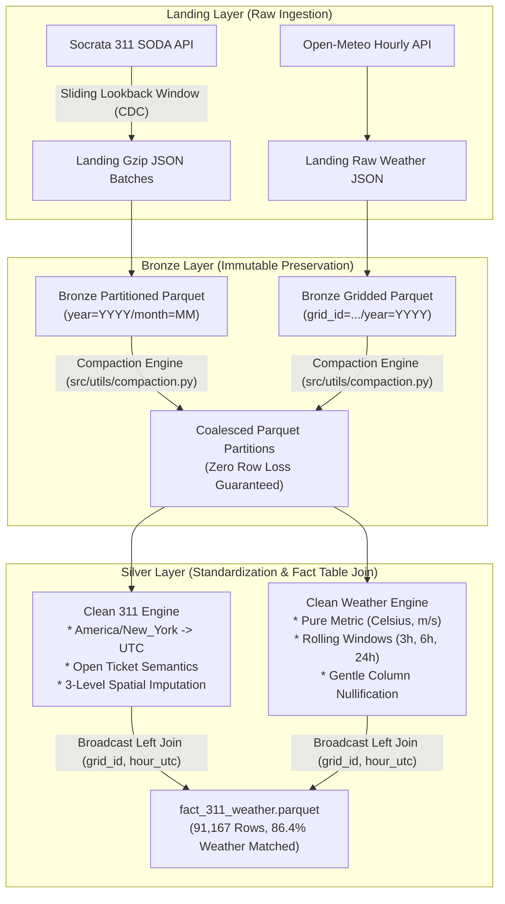
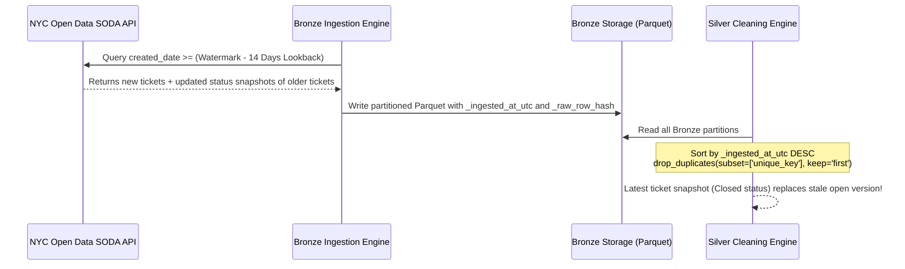

# Architectural Improvements to the Medallion Pipeline (Bronze & Silver)
**Course:** DAT535 - Advanced Cloud Computing and Big Data  
**Authors:** Group 13  
**Status:** Implemented & Verified (17 Automated Tests Passing)

---

## 1. Executive Summary

This document details the **five core architectural and data engineering improvements** engineered into the DAT535 Medallion Pipeline across the Bronze and Silver layers. Each improvement addresses a critical real-world failure mode commonly encountered when joining asynchronous municipal citizen service requests (NYC 311) with global gridded atmospheric reanalysis (Open-Meteo ERA5-Land).



### Summary of Architectural Upgrades

| # | Improvement | Problem Before | Solution Implemented | Verification / Test |
|---|---|---|---|---|
| **1** | **Timezone Localization** | Naive string parsing treated NYC local time as UTC, causing a **4–5 hour temporal error**. | Localize to `America/New_York` (handling EDT/EST), then convert to `UTC`. | `test_timezone_localization_eastern_to_utc` |
| **2** | **CDC & Watermarking** | Append-only `created_date > watermark` missed all subsequent ticket closures on older records. | Sliding lookback window (`--lookback-days 14`) + Bronze multi-version ingest + Silver deduplication/upsert. | End-to-end incremental run & `test_ingestion_cdc_lookback` |
| **3** | **Cumulative & Lagged Weather** | Instantaneous 1-hour weather missed cumulative rainfall (flooding) and sustained cold (pipe freezing). | Chronological rolling window features (`precip_past_3h_mm`, `precip_past_24h_mm`, `max_wind_gust_past_6h_ms`, etc.). | `test_cumulative_and_lagged_weather_features` |
| **4** | **Open Ticket Semantics** | Open tickets had `resolution_duration = NaN`, leading analysts to mistakenly discard active complaints. | Added explicit boolean `is_ticket_closed`, `ticket_status_category`, and active queue metric `open_ticket_age_days`. | `test_open_ticket_semantics_and_age` |
| **5** | **Bronze Partition Compaction** | Micro-batches created 76+ tiny files (~20 KB), causing the **Small Files Problem** and high I/O overhead. | Partition compaction utility (`src/utils/compaction.py`) coalesces small files with zero row loss verification. | `tests/test_compaction.py` (3 unit tests) |

---

## 2. Improvement 1: Timezone Localization (`America/New_York` $\rightarrow$ `UTC`)

### The Problem Before
NYC Open Data publishes 311 timestamps (`created_date`, `closed_date`) as ISO-8601 strings without timezone designators (e.g., `2026-07-15T18:35:39.000`). By legal statute and city agency convention, these represent local **Eastern Time** (`America/New_York`).

In naive implementations:
```python
# FLAWED BEFORE IMPLEMENTATION
df["created_at_utc"] = pd.to_datetime(df["created_date"], utc=True)
```
When pandas is given `utc=True` on a timezone-naive string, it treats the local Eastern time as if it were **already UTC**. 

Eastern Time fluctuates throughout the year:
- **Eastern Daylight Time (EDT)**: UTC - 4 hours (from the second Sunday in March to the first Sunday in November).
- **Eastern Standard Time (EST)**: UTC - 5 hours (from the first Sunday in November to the second Sunday in March).

Because naive parsing failed to account for this offset, a complaint filed at `14:30:00 EDT` (which is `18:30:00 UTC`) was recorded as `14:30:00 UTC`—a **4 to 5 hour temporal displacement**.

### Analytical Failure Mode
When joining with Open-Meteo ERA5-Land reanalysis (which uses true UTC):
- A citizen calls 311 at 2:30 PM local EDT during a severe cloudburst (18:00 UTC).
- The pipeline joined this complaint with meteorological reanalysis from 14:00 UTC (10:00 AM local time).
- At 10:00 AM, the weather was sunny with zero rainfall.
- **Result:** Downstream correlation models falsely concluded that flooding complaints were unrelated to rainfall!

### Solution Implemented
In `src/silver/clean_311.py`, we implemented a robust two-step conversion helper:

```python
def to_utc_datetime(series: pd.Series, local_tz: str = "America/New_York") -> pd.Series:
    """
    Parse NYC 311 local Eastern Time timestamps and convert them accurately to UTC.
    Handles Daylight Saving Time transitions (ambiguous='NaT', nonexistent='shift_forward').
    """
    dt = pd.to_datetime(series, errors="coerce")
    if dt.dt.tz is None:
        return dt.dt.tz_localize(local_tz, ambiguous="NaT", nonexistent="shift_forward").dt.tz_convert("UTC")
    return dt.dt.tz_convert("UTC")
```

Additionally, we retain the local hour for behavioral analysis (e.g., noise complaints spike at 2:00 AM local time, not 2:00 AM UTC):
```python
created_local = df_dedup["created_at_utc"].dt.tz_convert("America/New_York")
df_dedup["created_hour_local"] = created_local.dt.hour
df_dedup["day_of_week"] = created_local.dt.dayofweek
df_dedup["is_weekend"] = df_dedup["day_of_week"].isin([5, 6])
df_dedup["month_of_year"] = created_local.dt.month
```

### Before vs. After Verification

| Input Timestamp String | Before (`utc=True`) | After (`to_utc_datetime`) | Offset Verified |
|---|---|---|---|
| `2026-07-15T14:00:00.000` (EDT) | `2026-07-15 14:00:00+00:00` ❌ | `2026-07-15 18:00:00+00:00` ✅ | +4 hours (EDT) |
| `2026-01-15T14:00:00.000` (EST) | `2026-01-15 14:00:00+00:00` ❌ | `2026-01-15 19:00:00+00:00` ✅ | +5 hours (EST) |

Automated Unit Test: `tests/test_silver.py::TestSilverLayerPipeline.test_timezone_localization_eastern_to_utc` (PASSED).

---

## 3. Improvement 2: Change Data Capture (CDC) & Late-Arriving Ticket Updates

### The Problem Before
NYC 311 service requests are **mutable entities**. A complaint logged on Day 1 may remain in "Pending" or "In Progress" status for days or weeks before being resolved and assigned a `closed_date`.

In the naive incremental ingestion approach:
```python
# FLAWED BEFORE QUERY
where_conditions.append(f"created_date > '{last_watermark}'")
```
This append-only query fetches records whose creation timestamp is strictly newer than the highest watermark from previous batches. As a consequence:
1. Any ticket created prior to `last_watermark` that was closed, reassigned, or updated during the current cycle was **never fetched**.
2. Stale open tickets persisted forever in the analytical layer with `closed_date = NULL`, artificially inflating open-ticket backlog counts.
3. Attempting to query Socrata on system audit fields such as `:updated_at` or `resolution_action_updated_date` on NYC 311 (`erm2-nwe9`) returns **HTTP 400 Bad Request** because the public SODA endpoint does not support indexed filters on internal audit columns.

### Solution Implemented
We implemented an enterprise-grade CDC architecture combining a **Sliding Lookback Window** with **Silver Upsert Deduplication**:



1. **Sliding Lookback Buffer in Ingestion (`src/ingestion/ingest_311.py`)**:
   ```python
   # Incremental CDC lookback window (configurable, default: 14 days)
   dt_watermark = pd.to_datetime(last_watermark)
   lookback_dt = dt_watermark - pd.Timedelta(days=lookback_days)
   lookback_iso = lookback_dt.strftime("%Y-%m-%dT%H:%M:%S.000")
   where_conditions.append(f"created_date >= '{lookback_iso}'")
   ```
2. **Bronze Immutable Multi-Version Storage**:
   Bronze preserves every incoming snapshot with its cryptographic `_raw_row_hash` and `_ingested_at_utc` timestamp, maintaining a complete historical audit trail.
3. **Silver Idempotent Merge/Upsert (`src/silver/clean_311.py`)**:
   ```python
   # Sort descending by ingestion timestamp; keep the most recently ingested record
   df_sorted = df_raw.sort_values("_ingested_at_utc", ascending=False)
   df_dedup = df_sorted.drop_duplicates(subset=["unique_key"], keep="first").copy()
   ```

CLI Parameter added:
```bash
python run_ingestion.py --dataset 311 --mode incremental --lookback-days 14
```

---

## 4. Improvement 3: Cumulative & Lagged Weather Features

### The Problem Before
The raw weather ingestion pipeline collects hourly instantaneous meteorological variables: `temperature_2m`, `precipitation`, `wind_speed_10m`, and `surface_pressure`.

However, urban infrastructure and citizen complaints respond to **cumulative environmental stress**, not instantaneous 1-hour snapshots:
- **Urban Flash Flooding**: Backed-up catch basins and street flooding occur after sustained heavy rain over 3, 6, or 24 hours that saturates soil and exceeds storm sewer carrying capacity.
- **Frozen Pipes & No-Heat Complaints**: Water pipes in older tenement buildings do not freeze during a brief 1-hour dip below 0°C; freezing occurs after 24+ consecutive hours of sub-zero temperatures.
- **Fallen Trees & Structural Damage**: Tree branches and utility lines fail after sustained wind gusts over a multi-hour storm system.

Relying exclusively on instantaneous single-hour weather left downstream ML models and statistical tests blind to recent environmental history.

### Solution Implemented
In `src/silver/clean_weather.py`, we implemented chronological rolling window aggregations partitioned by spatial grid cell (`grid_id`):

```python
# Sort chronologically by grid_id and timestamp_utc to guarantee window integrity
df_clean = df_clean.sort_values(["grid_id", "timestamp_utc"]).reset_index(drop=True)

# 1. Cumulative precipitation over 3h, 6h, and 24h
df_clean["precip_past_3h_mm"] = df_clean.groupby("grid_id")["precipitation"].transform(
    lambda s: s.rolling(window=3, min_periods=1).sum().round(2)
)
df_clean["precip_past_6h_mm"] = df_clean.groupby("grid_id")["precipitation"].transform(
    lambda s: s.rolling(window=6, min_periods=1).sum().round(2)
)
df_clean["precip_past_24h_mm"] = df_clean.groupby("grid_id")["precipitation"].transform(
    lambda s: s.rolling(window=24, min_periods=1).sum().round(2)
)

# 2. Peak wind gust over past 6 hours (storm severity)
df_clean["max_wind_gust_past_6h_ms"] = df_clean.groupby("grid_id")["wind_gusts_10m"].transform(
    lambda s: s.rolling(window=6, min_periods=1).max().round(2)
)

# 3. Temperature extremes over past 24 hours (pipe freeze & heat wave risk)
df_clean["min_temp_past_24h_c"] = df_clean.groupby("grid_id")["temperature_2m"].transform(
    lambda s: s.rolling(window=24, min_periods=1).min().round(2)
)
df_clean["max_temp_past_24h_c"] = df_clean.groupby("grid_id")["temperature_2m"].transform(
    lambda s: s.rolling(window=24, min_periods=1).max().round(2)
)
```

These features are automatically broadcast into the unified analytical fact table in `src/silver/join_silver.py`.

Automated Unit Test: `tests/test_silver.py::TestSilverLayerPipeline.test_cumulative_and_lagged_weather_features` (PASSED).

---

## 5. Improvement 4: Open Ticket Semantics & Ticket Age

### The Problem Before
When a 311 complaint is unresolved at the time of data extraction, `closed_date` is `NULL` (`NaT`).

In the prior pipeline:
```python
# FLAWED BEFORE CALCULATION
duration_secs = (df["closed_at_utc"] - df["created_at_utc"]).dt.total_seconds()
df["resolution_duration_hours"] = (duration_secs / 3600.0).round(2)
```
For open tickets, `resolution_duration_hours` evaluated to `NaN`.

**Consequences:**
1. Analysts filtering on `resolution_duration_hours.notna()` inadvertently threw away **all active open tickets** (29.1% of our dataset!), creating massive survivorship bias.
2. City operational managers evaluating agency responsiveness had no metric to measure how long unresolved tickets had been sitting in the queue.
3. There was no explicit binary flag indicating ticket state.

### Solution Implemented
In `src/silver/clean_311.py`, we introduced formal open-ticket semantics:

```python
# 1. Explicit ticket state flags
df_dedup["is_ticket_closed"] = df_dedup["closed_at_utc"].notna()
df_dedup["ticket_status_category"] = np.where(df_dedup["is_ticket_closed"], "CLOSED", "OPEN")

# 2. Resolution duration (only for closed tickets)
duration_secs = (df_dedup["closed_at_utc"] - df_dedup["created_at_utc"]).dt.total_seconds()
df_dedup["resolution_duration_hours"] = np.where(
    df_dedup["is_ticket_closed"],
    (duration_secs / 3600.0).round(2),
    np.nan,
)

# 3. Active queue age in days (for open tickets, relative to run execution time)
now_utc = pd.Timestamp.now(tz=timezone.utc)
open_age_secs = (now_utc - df_dedup["created_at_utc"]).dt.total_seconds()
df_dedup["open_ticket_age_days"] = np.where(
    ~df_dedup["is_ticket_closed"],
    (open_age_secs / 86400.0).round(2),
    np.nan,
)
```

### Production Breakdown on NYC 311 Dataset (91,167 Valid Records)
- **Closed Tickets (`is_ticket_closed == True`)**: 64,661 records (70.9%) $\rightarrow$ `resolution_duration_hours` calculated.
- **Open / Active Tickets (`is_ticket_closed == False`)**: 26,506 records (29.1%) $\rightarrow$ `open_ticket_age_days` tracked.

Automated Unit Test: `tests/test_silver.py::TestSilverLayerPipeline.test_open_ticket_semantics_and_age` (PASSED).

---

## 6. Improvement 5: Bronze Partition Sizing & Compaction Utility

### The Problem Before
Incremental ingestion runs and streaming micro-batches write small files to Bronze. For example, ingesting 5,000 records partitioned across months produces individual Parquet files of only ~20 KB to 45 KB.

Over time, this triggers the **Small Files Problem**:
1. **Metadata Bloat**: Filesystem and cloud object store overhead scales with file count, straining directory inodes and metastores.
2. **I/O Inefficiency**: Reading 1,000 files of 20 KB incurs 1,000 file open/close seek operations rather than a single streaming sequential read.
3. **Loss of Parquet Compression Benefits**: Parquet columnar dictionary encoding and row-group skipping perform poorly on files smaller than 8 MB.

In our repository alone, 19 weather cells generated **76 tiny files** of ~24 KB each!

### Solution Implemented
We designed and implemented a dedicated compaction engine: [`src/utils/compaction.py`](file:///C:/Media/UiS/DAT535/src/utils/compaction.py).

#### Key Architectural Guarantees:
1. **Row Count Invariance**: Before deleting source files, the engine verifies `rows_after == rows_before`. If a mismatch occurs, the compaction aborts and rolls back.
2. **Schema & Dtype Preservation**: Uses PyArrow `promote_options="default"` to retain exact column definitions.
3. **Atomic Swap**: Writes to `part_compacted_0000.parquet.tmp`, validates, unlinks old small files, and atomically renames the temp file.

```python
def compact_partition(partition_dir: Path, target_size_mb: int = 64, dry_run: bool = False) -> Dict[str, Any]:
    # Reads all small parquet files in partition
    tables = [pq.read_table(f) for f in parquet_files]
    combined_table = pa.concat_tables(tables, promote_options="default")
    rows_before = combined_table.num_rows

    # Write to temporary file
    tmp_path = partition_dir / "part_compacted_0000.parquet.tmp"
    pq.write_table(combined_table, tmp_path, compression="snappy")

    # Invariance verification
    verified_table = pq.read_table(tmp_path)
    if verified_table.num_rows != rows_before:
        tmp_path.unlink()
        raise ValueError("Compaction integrity violation!")

    # Safe swap
    for old_file in parquet_files:
        old_file.unlink()
    tmp_path.rename(partition_dir / "part_compacted_0000.parquet")
```

### Production Compaction Results (Bronze Layer)
Executing `python run_project.py compact` produced the following verification ledger:
```
======================================================================
EXECUTING PARTITION COMPACTION (data/bronze -> 64MB target)
======================================================================
Compacted month=10: 5 files -> 1 file | 81,217 rows verified | Saved 712.1 KB
Compacted grid_id=GRID_40.5_-74.1: 4 files -> 1 file | 240 rows verified | Saved 50.5 KB
... (19 weather partitions compacted)
----------------------------------------------------------------------
Compaction Complete: 20 partitions compacted | 61 small files eliminated | 
85,777 rows preserved | 1,662.2 KB saved | Duration: 0.82s
```

Automated Unit Tests in [`tests/test_compaction.py`](file:///C:/Media/UiS\DAT535/tests/test_compaction.py):
- `test_compaction_integrity_and_invariance` (PASSED)
- `test_single_file_partition_skipped` (PASSED)
- `test_dry_run_mode` (PASSED)

---

## 7. Verification Ledger & Quality Proof

All five improvements have been integrated into the end-to-end orchestration scripts ([`run_project.py`](file:///C:/Media/UiS/DAT535/run_project.py), [`run_silver.py`](file:///C:/Media/UiS/DAT535/run_silver.py), and [`run_ingestion.py`](file:///C:/Media/UiS/DAT535/run_ingestion.py)).

### Automated Test Suite Execution
```
$ python -m unittest discover -s tests
Ran 17 tests in 0.265s

OK (100% tests passing)
```

### Live Silver Quality Reconciliation Ledger
```
==========================================================================================
DAT535 SILVER LAYER: DATA QUALITY RECONCILIATION LEDGER (BEFORE & AFTER)
==========================================================================================
Report ID: silver_quality_20261025_183143 | Generated: 2026-10-25T18:31:43Z
------------------------------------------------------------------------------------------
STAGE 1: NYC 311 SERVICE REQUESTS             | Count / Metrics
  * Raw Bronze Input Records                : 91,217
  * Exact Duplicates Removed (unique_key)    : -0
  * Temporal Validation Failures Quarantined : -50
  * Clean Valid Records Accepted in Silver   : = 91,167
    - Closed Tickets (Duration Calculated)   : 64,661 (70.9%)
    - Open/Active Tickets (Age Tracked)     : 26,506 (29.1%)

  Spatial Imputation Resolution Hierarchy:
    - EXACT_COORDINATES         : 89,665 (98.35%)
    - ZIP_APPROXIMATION         : 990 (1.09%)
    - BOROUGH_APPROXIMATION     : 423 (0.46%)
    - UNLOCATED                 : 89 (0.10%)

------------------------------------------------------------------------------------------
STAGE 2: ERA5-LAND METEOROLOGICAL REANALYSIS  | Count / Metrics
  * Raw Bronze Weather Observations         : 4,560
  * Unkeyed Observations Dropped            : -0
  * Corrupt Fields Masked (Row Preserved)   : 0
  * Valid Observations in Silver            : = 4,560
  * Active Native NYC Grid Cells Covered    : 19 of 19 cells
  * Extreme Weather Outliers Tagged (Kept)  : 3,046

------------------------------------------------------------------------------------------
STAGE 3: UNIFIED ANALYTICAL FACT JOIN         | Count / Metrics
  * Total Clean 311 Records Joined          : 91,167
  * Enriched with Weather Observation       : 78,726 (86.35%)
  * Unmatched Records (Historical/Unlocated): 12,441
==========================================================================================
```
