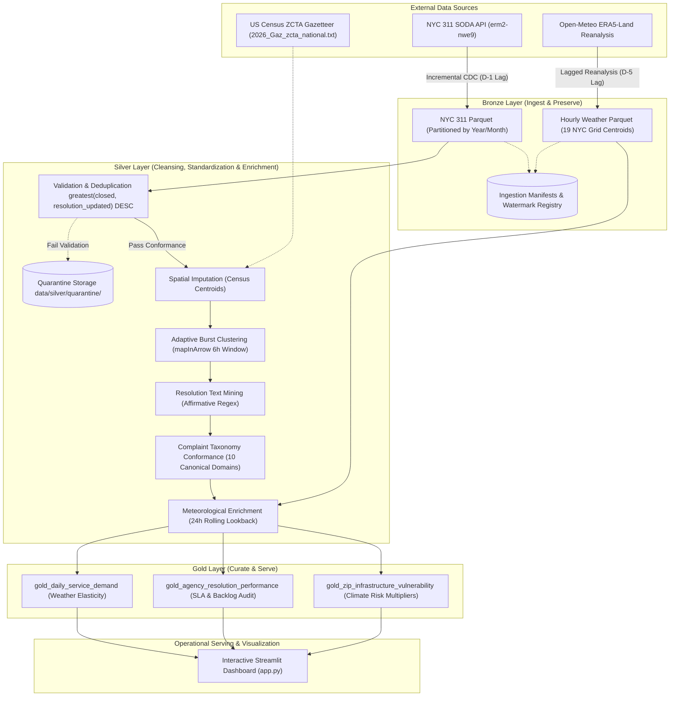

# NYC 311 & Weather Medallion Lakehouse Platform
### DAT535: Data Engineering | University of Stavanger (UiS)
**Course Project — Group 13**

[](https://www.python.org/)
[](https://spark.apache.org/)
[](#2-architecture)
[]()

An enterprise-grade **Medallion Lakehouse data pipeline** engineered with **PySpark 3.5.x**, processing and coupling multi-modal municipal event streams (NYC 311 Service Requests) with high-resolution reanalysis meteorological data (ECMWF ERA5-Land via Open-Meteo). 

Designed to operate robustly under real-world municipal data anomalies, the platform implements **CDC rolling watermarks**, **adaptive citizen call burst clustering**, **unstructured resolution text mining**, **categorical schema drift conformance**, and **automated quarantine isolation**.

---

## 📑 Table of Contents
1. [Project Overview](#1-project-overview)
2. [Architecture](#2-architecture)
3. [Features](#3-features)
4. [Repository Structure](#4-repository-structure)
5. [Requirements & Compatibility](#5-requirements--compatibility)
6. [Setup](#6-setup)
7. [Configuration](#7-configuration)
8. [Running the Pipeline](#8-running-the-pipeline)
9. [Automated Testing](#9-automated-testing)
10. [Performance Profiling & Benchmarking](#10-performance-profiling--benchmarking)
11. [CI/CD & Scheduled Operations](#11-cicd--scheduled-operations)
12. [Data Sources](#12-data-sources)
13. [Outputs & Operational Dashboard](#13-outputs--operational-dashboard)
14. [Assumptions & Known Limitations](#14-assumptions--known-limitations)

---

## 1. Project Overview

Municipal infrastructure across New York City experiences severe operational stress during extreme meteorological events—from torrential cloudbursts that overwhelm stormwater catch basins to sub-zero cold waves that trigger thousands of residential heating breakdowns. While NYC 311 captures millions of citizen complaints annually, raw municipal service logs exhibit three major operational data problems:
* **Redundant Call Surges**: Severe weather causes localized bursts of duplicate citizen reports for the same physical condition (e.g., dozens of calls for a single blocked catch basin or downed tree limb), artificially inflating perceived demand.
* **Administrative Closure Ambiguity**: Reported agency response times are heavily skewed by administrative dismissals (*"Officer arrived and found no condition"*, *"Advised managing agent"*) rather than genuine on-site physical repairs.
* **Temporal and Spatial Misalignment**: Service requests are filed with varying coordinate precisions and floating local timestamps (`America/New_York`), requiring rigorous harmonization with UTC meteorological observation grids.

### Core Objectives
This platform provides an end-to-end distributed Lakehouse pipeline that:
1. Ingests, conforms, and harmonizes millions of raw NYC 311 service requests with hourly ECMWF ERA5-Land meteorological observations.
2. Deflates duplicate citizen call bursts via in-memory streaming clustering while preserving individual ticket auditability.
3. Mines unstructured resolution narratives to separate true field repairs from administrative "phantom" closures.
4. Curates analytical data marts to evaluate the weather elasticity of municipal demand, track true agency response times, and identify neighborhood climate vulnerability hotspots across New York City.

---

## 2. Architecture

The platform follows the **Medallion Lakehouse Architecture** (Bronze $\to$ Silver $\to$ Gold), enforcing strict separation of concerns, data quality gates, and row-level lineage:



### Layer Responsibilities
* **Landing Layer**: Compressed raw JSON payloads (`.json.gz`) persisted directly from REST endpoints, preserving exact source auditability.
* **Bronze Layer**: Preserves raw source schema in append-only Parquet datasets partitioned by `year` and `month`. Ingestion manifests maintain dual watermarks (`source_data_start`, `source_data_end`) and audit metadata (`_batch_id`, `_ingested_at_utc`, `_source_file`).
* **Silver Layer**: Cleansed, validated, conformed, and enriched datasets:
  * Performs window deduplication on `unique_key` ordered by authoritative business mutation timestamps (`greatest(closed_at_utc, resolution_action_updated_date_utc).desc()`).
  * Enforces geographic bounding envelopes and isolates corrupted records into `data/silver/quarantine/`.
  * Imputes missing coordinates via US Census Bureau ZCTA centroids (`nyc_zip_centroids.parquet`).
  * Executes zero-copy PyArrow streaming burst clustering across 6 spatial hierarchies.
  * Classifies resolution narratives and conforms complaints to 10 invariant municipal domains.
  * Joins records to the nearest of 19 ERA5 weather grid centroids with 24-hour antecedent rolling weather metrics.
* **Gold Layer**: Curated analytical marts aggregated across temporal, spatial, and agency dimensions. Verified with zero-row-loss data quality ledgers before publication.
* **Serving Layer**: An interactive Streamlit decision support platform (`app.py`) providing visual analysis of demand elasticity, agency SLA gaps, and neighborhood climate risk.

---

## 3. Features

### Incremental Ingestion & CDC Dual Watermarking
* Tracks independent watermarks on `created_date` and `resolution_action_updated_date`.
* Employs a 3-clause business mutation window to capture retroactive ticket closures and status updates without requiring full dataset scans.
* Decoupled ingestion schedules account for differing source publication cadences: NYC 311 updates daily ($D-1$), whereas ECMWF ERA5-Land reanalysis is released with a 5-day scientific verification delay ($D-5$).

### Automated Data Validation & Quarantine Isolation
* Validates geographic coordinates against the official NYC bounding envelope ($40.40^\circ \le \text{lat} \le 41.05^\circ$, $-74.30^\circ \le \text{lon} \le -73.65^\circ$).
* Enforces physical boundary rules on meteorological sensor readings:
  * Ambient 2m temperature: $[-35.0^\circ\text{C}, 45.0^\circ\text{C}]$
  * Apparent temperature (heat index / wind chill): $[-45.0^\circ\text{C}, 55.0^\circ\text{C}]$
  * Precipitation $\ge 0.0\text{ mm}$, wind speed $\ge 0.0\text{ m/s}$
* Unkeyed entries, invalid timestamps, corrupt lineage, and negative durations are isolated to `data/silver/quarantine/nyc311/quarantined_311.parquet` and `data/silver/quarantine/weather/quarantined_weather.parquet` without halting pipeline runs. Sensor spikes outside physical limits are masked to `NULL` and logged to the sensor anomaly ledger.

### Adaptive Burst Clustering & Duplicate Deflation
* Routes complaints through 6 hierarchical spatial categories (`loc_key`: Parcel Buildings via BBL/House#, Highway Corridors, Intersections, Blockfaces, Landmarks/Parks, Fallback Intersections) to prevent spatial skew.
* Applies a Ticket-1 anchored adaptive sessionization window (`burst_window_hours = 6.0`): $\max(T_0 + 6\text{h}, \text{Ticket}_1\text{ closed})$.
* Implemented via PySpark `DataFrame.mapInArrow()` using PyArrow C++ compute (`pc.sort_indices`), appending `is_burst_duplicate`, `incident_cluster_id`, `burst_sequence_num`, and `cluster_size` in-stream to completely eliminate distributed self-joins.
* Deflates duplicate citizen call bursts during storm events while preserving full ticket-level auditability.

### Resolution Text Mining & SLA Auditing
* Mines unstructured closing descriptions using affirmative regular expression matching with negation-first rules (*"officer arrived and condition did not exist"* vs. *"action taken and condition repaired"*).
* Distinguishes true on-site physical remediation from administrative "phantom" closures.
* Tracks agency-level closure patterns and provides visibility into active backlog accumulation and true field remediation timelines.

### Conformed Semantic Taxonomy
* NYC 311 categorizes requests using over 250 volatile strings that shift across mayoral administrations.
* Maps requests across all agencies into **10 Invariant Municipal Service Domains** (`WATER_INFRASTRUCTURE`, `SEWER_STORMWATER`, `HEATING_HOT_WATER`, `ACOUSTIC_DISTURBANCE`, etc.).
* Unmapped or newly emerging categories route safely to `OTHER_CIVIC_SERVICES` and are logged in real time to `data/metadata/quality/unmapped_complaint_taxonomy_ledger.parquet`.

---

## 4. Repository Structure

```text
group13-dat535/
├── .github/workflows/          # CI/CD and automated pipeline execution
│   ├── dat535-dev.yml          # Pull request quality gate and automated test runner
│   ├── dat535-prod.yml         # Production deployment pipeline (workflow_dispatch)
│   └── pipeline.yml            # Scheduled daily incremental run (14:00 UTC)
├── data/
│   ├── bronze/                 # Append-only partitioned Parquet storage (nyc311, weather)
│   ├── gold/marts/             # Production analytical data marts
│   ├── landing/                # Compressed raw API payloads (.json.gz)
│   ├── metadata/
│   │   ├── benchmarks/         # Stage-level runtime and throughput benchmark JSONs
│   │   ├── manifests/          # Tier 1 ingestion run manifests and watermarks
│   │   └── quality/            # Observability ledgers (sensor anomalies, unmapped taxonomy)
│   ├── reference/              # Census Gazetteer (2026_Gaz_zcta_national.txt) & borough GeoJSON
│   └── silver/                 # Cleansed, enriched, and conformed single-source-of-truth Parquet
│       └── quarantine/         # Isolated invalid records (nyc311/quarantined_311, weather)
├── docs/                       # Technical architecture dossiers, data dictionaries, and setup guides
│   └── SELF_HOSTED_RUNNER_SETUP.md # Complete OpenStack VM & self-hosted runner provisioning guide
├── notebooks/                  # Exploratory analyses and analytical showcase notebooks
│   ├── 09_landing_and_bronze_showcase.ipynb
│   ├── 10_silver_layer_showcase.ipynb
│   ├── 12_gold_layer_business_marts_showcase.ipynb
│   ├── 14_sub_resolution_text_robustness_audit.ipynb
│   ├── 15_categorical_schema_drift_and_semantic_conformance_proof.ipynb
│   └── 21_october_analytical_findings.ipynb
├── scripts/                    # Infrastructure and deployment automation
│   └── setup_spark_env.sh      # Automated Linux VM provisioning (Java 8, Spark 3.5.0, Python 3.11 venv)
├── src/
│   ├── gold/                   # Gold data mart aggregation builders
│   │   ├── build_agency_performance.py
│   │   ├── build_gold.py
│   │   ├── build_service_demand.py
│   │   ├── build_zip_vulnerability.py
│   │   └── config.py
│   ├── ingestion/              # Ingestion clients (NYC 311 SODA & Open-Meteo ERA5)
│   │   ├── ingest_311.py
│   │   └── ingest_weather.py
│   ├── silver/                 # Silver layer cleaning, clustering, mining, and conformance
│   │   ├── clean_311.py
│   │   ├── clean_weather.py
│   │   ├── config.py
│   │   ├── incident_clustering.py
│   │   ├── join_silver.py
│   │   ├── quality_report.py
│   │   ├── resolution_text_mining.py
│   │   ├── semantic_conformance.py
│   │   └── spatial_cleaning.py
│   └── utils/                  # Shared utilities (Spark session, CDC manifests, compaction)
│       ├── benchmark.py
│       ├── build_reference_zip_centroids.py
│       ├── compaction.py
│       ├── config.py
│       ├── manifest.py
│       ├── partitioning.py
│       ├── publish_ci_summary.py
│       └── spark.py
├── tests/                      # Automated unit, mock, and integration test suite
│   ├── test_compaction.py
│   ├── test_gold.py
│   ├── test_ingestion.py
│   ├── test_pipeline_e2e.py
│   ├── test_resolution_mining.py
│   ├── test_semantic_conformance.py
│   └── test_silver.py
├── .env.example                # Template configuration file
├── app.py                      # Interactive Streamlit operational intelligence platform
├── requirements.txt            # Python dependencies
├── run_project.py              # Master pipeline CLI orchestrator
├── run_ingestion.py            # Bronze ingestion runner CLI
├── run_silver.py               # Silver transformation runner CLI
└── run_gold.py                 # Gold mart generation runner CLI
```

---

## 5. Requirements & Compatibility

### Core Prerequisites
* **Python**: 3.10 or 3.11
* **Apache Spark / PySpark**: 3.5.x
* **Java Runtime**: OpenJDK 8, 11, or 17
* **Operating System**: Linux, macOS, or Windows (Windows requires `winutils.exe` & `hadoop.dll`, see [Setup Step 4](#4-windows-users-only-hadoop--winutils-setup))

### Java ↔ PySpark Version Compatibility
> [!IMPORTANT]
> The project pins `pyspark>=3.5.0,<4.0.0` to maintain compatibility with OpenJDK 8, 11, and 17 runtimes on student laptops and self-hosted Linux CI runners. PySpark 4.x compiled bytecode requires Java 17+ (class file version 61.0); executing PySpark 4.x against Java 8 or 11 results in `java.lang.UnsupportedClassVersionError`. The centralized session factory in `src/utils/spark.py` automatically validates and selects compatible runtimes.

### Primary Python Dependencies
* Distributed Processing: `pyspark>=3.5.0,<4.0.0`, `pyarrow>=12.0.0`, `pandas>=2.0.0`, `numpy>=1.24.0,<2.0.0`, `findspark>=2.0.1`
* Ingestion & Environment: `requests>=2.28.0`, `urllib3>=2.0.0`, `python-dotenv>=1.0.0`
* Visualization & Dashboard: `streamlit>=1.30.0`, `plotly>=5.18.0`
* Automated Testing: `pytest>=7.4.0`
* Exploratory Notebooks: `matplotlib>=3.7.0`, `seaborn>=0.12.0`, `scipy>=1.10.0`, `scikit-learn>=1.3.0`

---

## 6. Setup

### 1. Clone the Repository
```bash
git clone https://github.com/GabIsr/group13-dat535.git
cd group13-dat535
```

### 2. Create and Activate Virtual Environment
Using `venv`:
```bash
# Linux / macOS
python -m venv .venv
source .venv/bin/activate

# Windows PowerShell
python -m venv .venv
.venv\Scripts\Activate.ps1
```

Or using `conda`:
```bash
conda create -n dat535 python=3.11 -y
conda activate dat535
```

### 3. Install Dependencies
```bash
pip install -r requirements.txt
```

### 4. Windows Users Only: Hadoop & winutils Setup
Apache Spark requires Hadoop native binaries (`winutils.exe` and `hadoop.dll`) to interact with the local filesystem on Windows. *(Linux and macOS users do not need this and can skip to Section 7).*

The pipeline automatically detects and configures Hadoop if placed inside the repository root (`hadoop/` is ignored by Git). Run the following commands in PowerShell from the repository root:

```powershell
# 1. Create hadoop/bin folder
New-Item -ItemType Directory -Force -Path hadoop\bin

# 2. Download Hadoop 3.3.6 native binaries from the cdarlint/winutils community repository
Invoke-WebRequest -Uri "https://raw.githubusercontent.com/cdarlint/winutils/master/hadoop-3.3.6/bin/winutils.exe" -OutFile "hadoop\bin\winutils.exe"
Invoke-WebRequest -Uri "https://raw.githubusercontent.com/cdarlint/winutils/master/hadoop-3.3.6/bin/hadoop.dll" -OutFile "hadoop\bin\hadoop.dll"
```

*(Alternatively, if you already have Hadoop configured system-wide, ensure `HADOOP_HOME` is set in your environment variables pointing to your installation).*

---

## 7. Configuration

Copy the example environment configuration file:
```bash
cp .env.example .env
```

Edit `.env` to configure pipeline settings:

| Variable | Default Value | Description |
| :--- | :--- | :--- |
| `SOCRATA_APP_TOKEN` | *(None / Optional)* | Socrata Open Data API app token. Optional for local development; recommended for production and high-volume queries to avoid rate throttling. In GitHub Actions, configure this as a repository secret. |
| `DAT535_ENV` | `dev` | Target execution environment (`dev` or `prod`). |
| `DAT535_PROJECT_START_DATE` | `2026-07-15T00:00:00.000` | Universal lower bound boundary for Change Data Capture (CDC). |
| `DAT535_OUTPUT_DIR` | `<project_root>/data` | Root output directory for Landing, Bronze, Silver, Gold, and metadata stores. |

> [!TIP]
> **Configuring `SOCRATA_APP_TOKEN` in GitHub Actions**:  
> If you want automated workflows (`.github/workflows/pipeline.yml` and `dat535-dev.yml`) to use a token:
> 1. In your GitHub repository, navigate to **Settings** $\to$ **Secrets and variables** $\to$ **Actions**.
> 2. Click **New repository secret**.
> 3. Name: `SOCRATA_APP_TOKEN`
> 4. Value: Paste your Socrata App Token and save.
> 
> The workflows automatically bind `${{ secrets.SOCRATA_APP_TOKEN }}` to the environment during automated scheduled runs and pull request gates.

---

## 8. Running the Pipeline

The repository provides a unified master orchestrator (`run_project.py`) alongside dedicated runners for individual layers.

### Command-Line Arguments & Parameters

The pipeline scripts accept the following CLI parameters:

#### Master Orchestrator Options (`run_project.py`)
* **`action`** *(positional, default: `all`)*: Specifies the pipeline layer or task to execute:
  * `all`: Executes the complete pipeline end-to-end (Bronze $\to$ Silver $\to$ Gold).
  * `bronze`: Runs raw REST landing and append-only Bronze ingestion.
  * `silver`: Runs data cleaning, spatial imputation, burst clustering, resolution text mining, taxonomy mapping, and broadcast fact joining.
  * `gold`: Aggregates the 3 analytical data marts and generates the data quality reconciliation ledger.
  * `test`: Executes the full automated unit and integration test suite.
  * `compact`: Coalesces fragmented small Parquet partitions in Bronze storage to a 64 MB target file size.
* **`--env`** *(`dev` \| `prod`, default: `dev`)*: Target execution environment. `dev` uses isolated development directories; `prod` targets production storage paths.
* **`--mode`** *(`incremental` \| `backfill`, default: `incremental`)*:
  * `incremental`: Uses CDC watermarks stored in manifests to ingest only newly created or mutated records since the previous batch.
  * `backfill`: Pulls historical partitions across a specified date window and writes an authoritative success manifest (`source_data_end`), which subsequent incremental CDC runs smoothly resume from without data gaps.
* **`--start-date`** *(string, format: `YYYY-MM-DD`, optional)*: Lower date boundary for partition-scoped execution or historical backfill.
* **`--end-date`** *(string, format: `YYYY-MM-DD`, optional)*: Upper date boundary for partition-scoped execution or historical backfill.
* **`--compact`** *(flag, default: disabled)*: When passed with `all` or `bronze`, automatically triggers partition compaction on Bronze files immediately following ingestion.

#### Layer-Specific Options
* **Ingestion (`run_ingestion.py`)**:
  * **`--dataset`** *(`all` \| `311` \| `weather`, default: `all`)*: Selects whether to ingest both streams or isolate a single data provider.
  * **`--batch-size`** *(integer, default: `50000`)*: Number of records requested per HTTP GET page from the Socrata SODA API.
  * **`--max-records`** *(integer, optional)*: Hard limit on total records to ingest (useful for quick local smoke testing).
  * **`--force`** *(flag, default: disabled)*: Bypasses idempotency guards to re-ingest a date range or batch ID even if already recorded in manifests.
  * **`--lookback-days`** *(integer, default: `7`)*: Buffer lookback in days when no prior watermark exists.
  * **`--lag-311`** *(integer, default: `1`)*: Publication lag buffer in days for NYC 311 ($D-1$).
  * **`--lag-weather`** *(integer, default: `5`)*: Publication lag buffer in days for ECMWF ERA5-Land reanalysis ($D-5$).
  * **`--app-token`** *(string, optional)*: Explicit Socrata App Token override (bypasses `.env` setting).
* **Silver (`run_silver.py`)**:
  * **`--stage`** *(`all` \| `311` \| `weather` \| `join`, default: `all`)*: Allows running individual Silver transformation steps in isolation.
* **Gold (`run_gold.py`)**:
  * Scoped execution via `--start-date` and `--end-date` to recompute monthly analytical mart slices.

---

### Master Pipeline Execution (`run_project.py`)

Execute the complete end-to-end pipeline (Bronze $\to$ Silver $\to$ Gold):
```bash
python run_project.py all --env dev
```

Run specific pipeline layers:
```bash
# Bronze ingestion only
python run_project.py bronze --env dev

# Silver standardization and joins only
python run_project.py silver --env dev

# Gold analytical marts only
python run_project.py gold --env dev

# Run partition compaction on Bronze storage
python run_project.py compact
```

### Layer-Specific Runners

#### 1. Ingestion Runner (`run_ingestion.py`)
```bash
# Incremental daily ingestion (CDC mode)
python run_ingestion.py --dataset all --mode incremental --env dev

# Historical backfill mode for a specific date window
python run_ingestion.py --dataset all --mode backfill --start-date 2026-10-01 --end-date 2026-10-31 --env dev

# Ingest single source (311 or weather)
python run_ingestion.py --dataset 311 --mode incremental --env dev
python run_ingestion.py --dataset weather --mode incremental --env dev
```

#### 2. Silver Runner (`run_silver.py`)
```bash
# Run all Silver stages (cleaning, spatial imputation, clustering, text mining, taxonomy, joins)
python run_silver.py --stage all --env dev

# Run individual Silver stages
python run_silver.py --stage 311 --env dev
python run_silver.py --stage weather --env dev
python run_silver.py --stage join --env dev
```

#### 3. Gold Runner (`run_gold.py`)
```bash
# Build all Gold data marts
python run_gold.py --env dev

# Build Gold data marts for a specific monthly partition window
python run_gold.py --env dev --start-date 2026-10-01 --end-date 2026-10-31
```

#### 4. Launch Operational Dashboard (`app.py`)
After the Gold marts are generated, launch the interactive browser-based Streamlit application:
```bash
streamlit run app.py
```
*(Opens the local web server at `http://localhost:8501` to explore curated analytical views)*

---

## 9. Automated Testing

The project maintains an automated test suite covering unit operations, API mocking, and end-to-end integration:

```bash
# Run the complete test suite via pytest
pytest tests/

# Or via the master CLI
python run_project.py test

# Or via Python standard unittest
python -m unittest discover -s tests
```

### Test Suite Coverage (83 Tests Passing)
* `tests/test_ingestion.py`: Socrata/Open-Meteo API response parsing, rate-limiting retry handling, pagination, and watermark progression.
* `tests/test_silver.py`: Window deduplication rank ordering, coordinate bounding box validation, Census centroid imputation, and quarantine isolation.
* `tests/test_resolution_mining.py`: Affirmative regex pattern validation, negation phrase trapping, and classification accuracy.
* `tests/test_semantic_conformance.py`: Canonical taxonomy mapping and unmapped category routing.
* `tests/test_gold.py`: Zero-row-loss reconciliation across aggregations, SLA calculation correctness, and data mart schemas.
* `tests/test_compaction.py`: Partition compaction verification ensuring no records are lost or duplicated during small-file coalescing.
* `tests/test_pipeline_e2e.py`: End-to-end Write-Audit-Publish (WAP) validation across Bronze, Silver, and Gold.

---

## 10. Performance Profiling & Benchmarking

The pipeline integrates automated stage-level profiling via `src/utils/benchmark.py`:
* **Telemetry Recorded**: Step-level duration, input/output row counts, processed bytes, memory usage, and row throughput.
* **Profile Persistence**: Saved automatically as timestamped JSON documents to `data/metadata/benchmarks/{run_id}.json`, with atomic pointer updates to `latest_benchmark.json`.
* **Summary Table**: Printed directly to the terminal at the conclusion of every `run_project.py` execution, detailing execution times and throughput per pipeline stage.

---

## 11. CI/CD & Scheduled Operations

Continuous integration and automated scheduling are implemented using **GitHub Actions** running on a dedicated self-hosted Linux cloud environment:

* **Dev Pipeline & Quality Gate (`.github/workflows/dat535-dev.yml`)**:
  * Triggers automatically on pull requests and pushes to `dev`.
  * Verifies PySpark 3.5.x alignment with Java 8, executes the automated test suite gate, and runs an incremental Dev pipeline into `$HOME/spark-lab-data/dev`.
* **Production Deployment (`.github/workflows/dat535-prod.yml`)**:
  * Triggers automatically upon merging pull requests into `main` (or via manual `workflow_dispatch`), targeting `$HOME/spark-lab-data/prod` with manual reviewer deployment protection gates.
* **Scheduled Daily Incremental CDC (`.github/workflows/pipeline.yml`)**:
  * Runs daily at **14:00 UTC** via cron (`0 14 * * *`).
  * **Publication Lag Alignment**: ECMWF publishes daily ERA5T reanalysis (5-day delay, $D-5$) by 12:00 UTC. The 14:00 UTC schedule provides a 2-hour buffer for Open-Meteo indexing, ensuring complete meteorological coverage before 311 joins and Gold mart aggregations.

### Self-Hosted Cloud Runner Infrastructure
To avoid compute constraints and allow persistent state preservation between incremental pipeline runs, orchestration executes on a dedicated university cloud VM:
* **Compute Infrastructure**: Ubuntu 22.04 LTS instance provisioned on the UiS OpenStack cluster (`m1.large` flavor: 4 vCPUs, 8 GB RAM, 80 GB disk).
* **Execution Runtime**: Apache Spark 3.5.0 with OpenJDK 8 and a dedicated Python 3.11 virtual environment (`~/spark-env`).
* **Lakehouse Persistence**: Isolated non-ephemeral directories (`$HOME/spark-lab-data/dev` and `$HOME/spark-lab-data/prod`) ensuring Parquet tables and metadata ledgers persist across VM reboots and job runs.
* **Daemon Management**: Configured as a background `systemd` daemon service (`actions.runner.*`) with automatic recovery and restart on boot.

> [!TIP]
> For the complete step-by-step guide on OpenStack Horizon provisioning, security groups, Spark environment scripts, and GitHub runner daemon registration, see the [Self-Hosted Runner Infrastructure Setup Guide](docs/SELF_HOSTED_RUNNER_SETUP.md).

---

## 12. Data Sources

| Source | Dataset Information Page | Query Endpoint / Download URL | Coverage / Resolution | Ingestion Cadence & Lag |
| :--- | :--- | :--- | :--- | :--- |
| **NYC 311 Service Requests** | [NYC Open Data (erm2-nwe9)](https://data.cityofnewyork.us/d/erm2-nwe9) | `https://data.cityofnewyork.us/resource/erm2-nwe9.json` | Non-emergency municipal complaints across all 5 boroughs | Ingested daily ($D-1$ publication lag) |
| **ECMWF ERA5-Land Reanalysis** | [Open-Meteo Historical Weather](https://open-meteo.com/en/docs/historical-weather-api) | `https://archive-api.open-meteo.com/v1/archive` | Hourly temperature, precipitation, pressure, wind gusts across 19 NYC grid points ($9\text{ km}$ resolution) | Ingested daily ($D-5$ scientific reanalysis lag) |
| **US Census ZCTA Gazetteer** | [US Census Bureau Gazetteer Files](https://www.census.gov/geographies/reference-files/time-series/geo/gazetteer-files.html) | `data/reference/2026_Gaz_zcta_national.txt` | National ZIP Code Tabulation Area (ZCTA) centroid coordinates | Static reference dataset |
| **NYC Borough Boundaries** | [NYC Open Data (gthc-hcne)](https://data.cityofnewyork.us/d/gthc-hcne) | `https://data.cityofnewyork.us/resource/gthc-hcne.geojson` | Vector boundary polygons for all 5 NYC boroughs | Static reference dataset (`data/reference/`) |

---

## 13. Outputs & Operational Dashboard

### Analytical Data Marts (Gold Layer)
Stored as optimized Apache Parquet tables under `data/gold/marts/`:

1. **`gold_daily_service_demand.parquet`**:
   * **Partitioning**: Partitioned by `year` and `month`
   * **Granularity**: `date × grid_id × borough × complaint_type`
   * **Metrics**: Total complaint count, distinct physical incidents, redundant burst calls, `total_precipitation_mm` (daily sum), `max_rolling_3h_precip_mm`, `max_rolling_6h_precip_mm`, `hours_of_precipitation`, `avg_temperature_c`, `min_temperature_c`, `max_temperature_c`, `max_wind_gust_ms`, extreme weather indicator.
   * **Use Case**: Quantifying weather elasticity across municipal service categories (wet vs. dry day demand shifts).

2. **`gold_agency_resolution_performance.parquet`**:
   * **Partitioning**: Partitioned by `year` and `month`
   * **Granularity**: `reporting_date × borough × agency`
   * **Metrics**: Daily intake volume, daily closures, active backlog count, long-open backlog ($>7$ days aging), phantom closure percentage, median and P90 resolution hours for field-verified remediations.
   * **Use Case**: Auditing true municipal agency field performance versus nominal administrative closure rates.

3. **`gold_zip_infrastructure_vulnerability.parquet`**:
   * **Partitioning**: Partitioned by `borough`
   * **Granularity**: `incident_zip × borough × complaint_type`
   * **Metrics**: Storm Sensitivity Multiplier (wet-to-dry complaint ratio), spatial distance to weather sensor, exact GPS percentage versus centroid-imputed percentage.
   * **Use Case**: Prioritizing neighborhood capital infrastructure investments and flood mitigation works.

### Observability Ledgers & Quarantines
* **Quality Ledgers (`data/metadata/quality/`)**:
  * `sensor_anomaly_ledger.parquet`: Records masked meteorological sensor anomalies exceeding physical boundaries.
  * `unclassified_resolutions_ledger.parquet`: Unrecognized closed resolution notes tracked for semantic drift.
  * `unmapped_complaint_taxonomy_ledger.parquet`: New or unclassified complaint types routed to `OTHER_CIVIC_SERVICES`.
* **Quarantine Storage (`data/silver/quarantine/`)**:
  * `nyc311/quarantined_311.parquet`: Records isolated due to missing primary keys, unparseable timestamps, corrupt batch lineage, or negative durations (coordinates are imputed via Census centroids, not quarantined).
  * `weather/quarantined_weather.parquet`: Observations isolated due to missing `grid_id` or unparseable timestamps.
* **Manifests (`data/metadata/manifests/`)**: JSON manifests recording batch row counts, SHA-256 schema fingerprints, and watermarks.

### Interactive Operational Dashboard (Streamlit)

The project includes an interactive web-based decision support platform built with **Streamlit** (`app.py`). It serves as an exploratory consumption layer designed to translate the analytical output of the Gold data marts into actionable insights for municipal operations, emergency management, and policy oversight.

> [!NOTE]
> The dashboard is not intended to display every single raw record or low-level dimensional cross-product present in the multi-gigabyte Gold marts. Instead, it serves a **curated, high-impact analytical slice**—synthesizing key operational phenomena (weather elasticity, resolution disparities, and neighborhood vulnerability) through interactive filtering, time-series charts, and geospatial maps.

#### Launching the Dashboard
Run the following command in your terminal to start the local Streamlit application server and launch the dashboard in your web browser:
```bash
streamlit run app.py
```
*(By default, this hosts the application locally and opens `http://localhost:8501`)*

#### Dashboard Modules & Analytical Views
The dashboard features unified sidebar controls for dynamic time-scoping (All Time, Month, Week, or Day) and borough filtering, powering five dedicated analytical views:

1. **📊 Overview**: High-level municipal intake KPIs, call burst deflation metrics (showing primary incident leads vs. redundant calls), distribution of top complaint domains, and cross-borough intake comparisons.
2. **🌧️ Weather & Demand**: Dual-axis hydrological timelines correlating daily complaint volumes against rainfall, wind gusts, and temperatures. Highlights the non-linear drainage tipping point ($15\text{ mm}$ precipitation threshold) and contrasts heating complaint demand across temperature brackets.
3. **🏛️ Agency Performance**: Unpacks the **"Accountability Divide"**, contrasting nominal reported closure times against empirical on-site repair times. Audits administrative "phantom" closures versus field-verified remediations, active cohort backlog growth, and long-open backlog aging ($>7$ days).
4. **📍 Neighborhoods (ZIP)**: Surfaces neighborhood-level climate risk rankings based on the Storm Sensitivity Multiplier (wet-to-dry day demand ratios). Visualizes spatial uncertainty by showing the proportion of exact GPS coordinates versus Census centroid-imputed locations across ZIP codes.
5. **🛡️ Data Quality**: Live Lakehouse observability monitoring ingestion watermarks, quarantine table volumes (quarantined records, masked sensor anomalies, and unmapped categories), and categorical schema conformance ledgers.

---

## 14. Assumptions & Known Limitations

* **ECMWF Reanalysis Publication Lag ($D-5$)**: ERA5-Land reanalysis is released by ECMWF with a 5-day scientific delay. While 311 complaints are ingested daily ($D-1$), the most recent 5 days of complaints maintain `is_weather_pending = true` until reanalysis data becomes available.
* **Deterministic Text Mining vs. Evolving Phrasing**: Resolution classification uses deterministic regular expressions based on established agency closure phrases. If an agency alters its internal canned response templates, regex rules require maintenance to prevent unclassified templates from accumulating in the observability ledger.
* **Storage Model & Concurrency**: The storage layer utilizes partitioned Apache Parquet (`mode("overwrite")`) with Write-Audit-Publish manifest tracking. It does not employ full ACID transaction logs (such as Delta Lake or Apache Iceberg); concurrent pipeline writers must be synchronized externally.
* **Spatial Meteorological Resolution**: ERA5-Land operates at a 9 km grid resolution. While 19 grid centroids cover New York City, hyper-local urban microclimates (such as localized cloudbursts or urban canyon wind effects) are smoothed across the 9 km cells.

---

## 👥 Course & Contributors
* **Course**: DAT535: Data Engineering
* **Institution**: University of Stavanger (UiS)
* **Team**: Group 13
* **Academic Term**: Fall 2026
