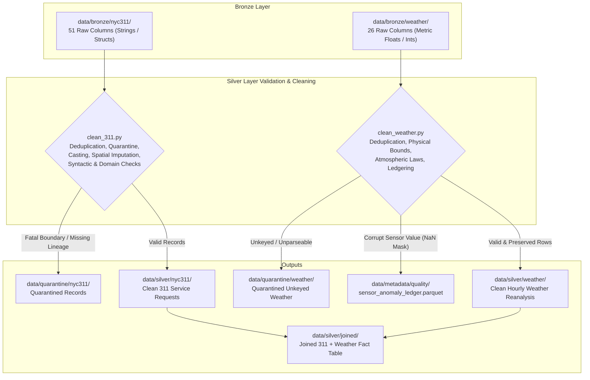

# Bronze to Silver Data Dictionary & Validation Matrix

This document provides a complete, column-by-column specification of all data transformations, type castings, physical and institutional validations, and anomaly handling mechanisms from the **Bronze** raw ingestion layer to the **Silver** cleaned and validated layer.

---

## 1. Architecture & Design Principles

1. **Lossless Ingestion (Bronze)**: Raw data is preserved as delivered by the upstream APIs (Socrata Open Data for 311, Open-Meteo ERA5-Land for Weather) with zero transformation, augmented with metadata lineage columns (`_batch_id`, `_ingested_at_utc`, `_source_file`, `_source_name`, `_extraction_mode`, `_schema_version`, `_raw_row_hash`).
2. **Strict Quarantining (Silver 311 & Weather)**: Fatal records (missing/non-numeric unique keys, negative resolution durations, pre-2003 epoch dates, future timestamps, missing/empty `_batch_id` lineage metadata, or unkeyed weather observations) are isolated to `data/quarantine/` without polluting downstream analytics.
3. **Syntactic vs. Soft Registry Agency Validation (Zero Data Loss)**:
   * **Syntactic Sanity**: Discards garbage (e.g. purely numeric strings like `"99999"`, strings $<2$ or $>10$ characters, or leaked addresses/descriptions).
   * **Soft Registry Tagging**: The 30+ official municipal agency acronyms from the 2025 Data Dictionary serve as an informational benchmark (`is_known_agency = True/False`). Legitimate unregistered or newly created task forces (e.g. `MOCJ`, `BPL`) are **never dropped or rejected**, but remain 100% intact with an informational audit note (`UNREGISTERED_AGENCY(...)`).
4. **Borough and Channel Domain Integrity**:
   * **Borough**: Validated against the 5 legal NYC boroughs (`MANHATTAN`, `BRONX`, `BROOKLYN`, `QUEENS`, `STATEN ISLAND`) plus `"UNSPECIFIED"`. Unrecognized boroughs are normalized to `"UNSPECIFIED"`, flagged in `is_valid_borough = False`, and logged in `quality_audit_notes`.
   * **Channel Type**: Standardized against `{"PHONE", "ONLINE", "MOBILE", "OTHER", "UNKNOWN"}`. Unrecognized channels are normalized to `"UNKNOWN"` and logged in `quality_audit_notes`.
5. **Zero-Information-Loss Sensor Ledgering (Silver Weather)**: Physical weather records are never deleted on sensor anomalies. Corrupt sensor fields are masked to `NaN`, while the exact raw value, violated rule, timestamp, and grid cell are logged in [`sensor_anomaly_ledger.parquet`](../data/metadata/quality/sensor_anomaly_ledger.parquet) and the row's `quality_audit_notes`. Real extreme storms are preserved and tagged in `is_extreme_weather`.
6. **Join Cartesian Guard**: Deduplication on `["grid_id", "timestamp_utc"]` combined with a hard assertion `assert len(df_joined) == len(df_311)` prevents 1-to-many Cartesian multiplications during feature joins.

---

---

---

---

## 2. NYC 311 Service Requests: Column-by-Column Matrix (51 Columns)

The raw Bronze dataset contains **51 columns**. The table below details the processing, type casting, validation criteria, and code locations for every single column in the PySpark pipeline.

| # | Bronze Raw Column | Raw Type | Silver Target Column | Casted Type | Validation & Business Rule | Action on Failure | Code Link |
|:---|:---|:---|:---|:---|:---|:---|:---|
| 1 | `unique_key` | `string` | `unique_key` | `LongType` | Must be numeric, strictly $>0$, non-null. Deduplicated via window keeping latest `source_updated_at` / `_ingested_at_utc`. | **Quarantined** (`INVALID_UNIQUE_KEY`) | [clean_311.py#L312-L356](../src/silver/clean_311.py#L312-L356) |
| 2 | `created_date` | `string` | `created_at_utc` | `TimestampType` | Parse America/New_York $\rightarrow$ UTC. Bound: $\ge \text{2003-03-01}$ and $\le \text{UTC now} + 2\text{h}$. | **Quarantined** (`INVALID_CREATED_DATE`) | [clean_311.py#L253-L255](../src/silver/clean_311.py#L253-L255) |
| 3 | `closed_date` | `string` | `closed_at_utc` | `TimestampType` | Parse America/New_York $\\rightarrow$ UTC. If present, resolution duration must be $\\ge 0.0$ hours. | **Quarantined** if negative duration (`NEGATIVE_DURATION`) | [clean_311.py#L256-L274](../src/silver/clean_311.py#L256-L274) |
| 4 | `agency` | `string` | `agency`, `is_known_agency` | `StringType`, `BooleanType` | Upper-cased, whitespace stripped. Checked against official 30+ agency list. | Tagged `is_known_agency = False` (never dropped) | [clean_311.py#L598-L613](../src/silver/clean_311.py#L598-L613) |
| 5 | `agency_name` | `string` | `agency_name` | `StringType` | Trimmed and standardized string. | Preserved as-is | [clean_311.py#L522](../src/silver/clean_311.py#L522) |
| 6 | `complaint_type` | `string` | `complaint_type` | `StringType` | Whitespace normalized, Title Case. | Nulls imputed to `"Unknown"` | [clean_311.py#L583-L584](../src/silver/clean_311.py#L583-L584) |
| 7 | `descriptor` | `string` | `descriptor` | `StringType` | Case preserved, whitespace trimmed. | Nulls imputed to `"Not Stated"` | [clean_311.py#L585-L586](../src/silver/clean_311.py#L585-L586) |
| 8 | `location_type` | `string` | `clean_exposure_setting` | `StringType` | Standardize 116 messy strings into 7 canonical exposure domains (Residential, Commercial, Street, Park, Transit, Public Facility, Other). | Standardized mapping | [14_unstructured_proof.ipynb#L13](../../14_unstructured_text_and_entity_resolution_proof.ipynb#L13) |
| 9 | `incident_zip` | `string` | `clean_incident_zip` | `StringType` | Regex extract `(/d{5})`. Preserved as zero-padded string (prevents leading zero loss). Checked against NYC metro ZIP prefixes. | Level 2 spatial fallback if coordinates missing | [clean_311.py#L367-L374](../src/silver/clean_311.py#L367-L374) |
| 10 | `incident_address` | `string` | `canonical_address` | `StringType` | Address canonicalization: uppercase, standardize suffixes (ST, AVE, BLVD), strip apt/unit numbers (`APT 4B`, `#2`). | Canonical key generated for burst sessionization | [14_unstructured_proof.ipynb#L13](../../14_unstructured_text_and_entity_resolution_proof.ipynb#L13) |
| 11 | `street_name` | `string` | `street_name` | `StringType` | Preserved as descriptive string. | Preserved as-is | [clean_311.py#L522](../src/silver/clean_311.py#L522) |
| 12-16 | Cross streets, intersections, address_type | `string` | *(same)* | `StringType` | Secondary spatial reference fields. Preserved intact. | Preserved as-is | [clean_311.py#L522](../src/silver/clean_311.py#L522) |
| 17 | `city` | `string` | `city` | `StringType` | Standardized uppercase USPS neighborhood name. | Preserved for jurisdictional cross-check | [clean_311.py#L522](../src/silver/clean_311.py#L522) |
| 18 | `landmark` | `string` | `landmark` | `StringType` | Descriptive public landmark identifier. | Preserved as-is | [clean_311.py#L522](../src/silver/clean_311.py#L522) |
| 19 | `status` | `string` | `status`, `canonical_status` | `StringType` | Validated against `KNOWN_311_STATUSES`. Reconciled against `closed_at_utc`. | Inconsistency flagged in `is_status_conflict` | [clean_311.py#L589-L597](../src/silver/clean_311.py#L589-L597) |
| 20 | `resolution_description` | `string` | `resolution_outcome_category`, `is_field_action`, `has_narrative_state_conflict` | `StringType`, `BooleanType` | Multi-stage regex NLP classifies narrative disposition: `SUBSTANTIATED_ACTION`, `FAILED_NO_ACCESS` (5.2%), `UNSUBSTANTIATED_GOA` (25.6%). Recognizes GOA/No-Access as legitimate non-action closures; flags stale narrative conflicts where text says open but status/date say closed. | Separates physical field repairs from legitimate "no action taken" closures; preserves timestamp precedence | [14_unstructured_proof.ipynb#L7](../../14_unstructured_text_and_entity_resolution_proof.ipynb#L7) |
| 21 | `resolution_action_updated_date` | `string` | `res_action_updated_utc` | `TimestampType` | Parse America/New_York $\\rightarrow$ UTC. | Fallback timestamp for ghost closures | [clean_311.py#L660-L662](../src/silver/clean_311.py#L660-L662) |
| 22 | `community_board` | `string` | `cb_district_num`, `cb_borough` | `IntegerType`, `StringType` | Parsed regex `^(/d{2})/s+([A-Z]+)$`. Cross-referenced against borough. | Recovers UNSPECIFIED boroughs | [14_unstructured_proof.ipynb#L17](../../14_unstructured_text_and_entity_resolution_proof.ipynb#L17) |
| 23 | `council_district` | `string` | `council_district` | `IntegerType` | Validated strictly against legal NYC Charter bounds $[1, 51]$. | Masked to `NULL` if outside $[1, 51]$ | [clean_311.py#L644-L649](../src/silver/clean_311.py#L644-L649) |
| 24 | `police_precinct` | `string` | `police_precinct` | `IntegerType` | Validated against active NYPD precinct bounds $[1, 123]$. | Masked to `NULL` if out of bounds | [clean_311.py#L650-L656](../src/silver/clean_311.py#L650-L656) |
| 25 | `bbl` | `string` | `bbl`, `bbl_borough` | `StringType` | 10-digit Borough-Block-Lot parcel tax ID. 1st digit encodes legal tax borough (1=MN, 2=BX, 3=BK, 4=QN, 5=SI). | Cross-referenced against `borough` | [14_unstructured_proof.ipynb#L17](../../14_unstructured_text_and_entity_resolution_proof.ipynb#L17) |
| 26 | `borough` | `string` | `borough`, `reconciled_borough` | `StringType` | Validated against 5 legal boroughs. If `"UNSPECIFIED"`, reconciled using ZIP prefix, CB, and BBL. | Recovers 384 unspecified records | [clean_311.py#L551-L562](../src/silver/clean_311.py#L551-L562) |
| 27-28 | `x_coordinate_state_plane`, `y_coordinate_state_plane` | `string` | `x_coord_state_plane`, `y_coord_state_plane` | `DoubleType` | EPSG:2263 NY Long Island State Plane bounds ($X \\in [900k, 1075k]$, $Y \\in [110k, 285k]$). | Masked to `NULL` if invalid | [clean_311.py#L629-L642](../src/silver/clean_311.py#L629-L642) |
| 29 | `open_data_channel_type` | `string` | `channel_type` | `StringType` | Validated against `PHONE`, `ONLINE`, `MOBILE`, `OTHER`, `UNKNOWN`. | Unrecognized mapped to `UNKNOWN` | [clean_311.py#L614-L623](../src/silver/clean_311.py#L614-L623) |
| 30-31 | `park_facility_name`, `park_borough` | `string` | *(same)* | `StringType` | Descriptive Parks Department metadata. | Preserved as-is | [clean_311.py#L522](../src/silver/clean_311.py#L522) |
| 32-33 | `latitude`, `longitude` | `string` | `latitude`, `longitude`, `spatial_imputation_level` | `DoubleType`, `StringType` | Validated against NYC bounding box $[40.48, 40.95]$ and $[-74.28, -73.65]$. | If null\\invalid, Level 2 Census ZCTA centroid imputed; tagged in `spatial_imputation_level` | [clean_311.py#L376-L453](../src/silver/clean_311.py#L376-L453) |
| 34 | `location` | `struct` | `location` | `StructType` | Socrata native GeoJSON struct `{"type": "Point", "coordinates": [...]}`. | Preserved intact | [clean_311.py#L522](../src/silver/clean_311.py#L522) |
| 35-44 | Secondary descriptors, vehicle/taxi, bridge/highway, due_date | `string` | *(same)* | `StringType`, `TimestampType` | Agency-specific routing metadata (TLC taxi pickups, DOT bridges). | Preserved intact; `due_date` parsed to UTC | [clean_311.py#L658-L659](../src/silver/clean_311.py#L658-L659) |
| 45-51 | `_batch_id`, `_ingested_at_utc`, `_source_file`, `_source_name`, `_extraction_mode`, `_schema_version`, `_raw_row_hash` | `string` | *(same)* | `StringType` | Ingestion lineage metadata. Validated: must not be null or whitespace. | Missing batch ID $/implies$ **Quarantined** (`CORRUPTED_LINEAGE`) | [clean_311.py#L323-L327](../src/silver/clean_311.py#L323-L327) |

---

## 3. Open-Meteo Weather Reanalysis: Column-by-Column Matrix (26 Columns)

The raw Bronze weather dataset contains **26 columns** covering meteorological variables and physical validation rules.

| # | Bronze Column | Raw Type | Silver Target Column | Casted Type | Meteorological & Physical Validation Rule | Action on Failure | Code Link |
|:---|:---|:---|:---|:---|:---|:---|:---|
| 1 | `time` | `string` | `timestamp_utc` | `TimestampType` | ISO-8601 UTC timestamp. Composite key with `grid_id`. | Quarantined to `quarantined_weather.parquet` | [clean_weather.py#L94-L101](../src/silver/clean_weather.py#L94-L101) |
| 2 | `temperature_2m` | `double` | `temperature_2m` | `DoubleType` | Validated against physical bounds $[-35.0^\\circ\\text{C}, 45.0^\\circ\\text{C}]$. NCEI Central Park all-time records: $-26.1^\\circ\\text{C}$ to $41.1^\\circ\\text{C}$. | Out of bounds masked to `NaN`, logged to Anomaly Ledger | [clean_weather.py#L203-L207](../src/silver/clean_weather.py#L203-L207) |
| 3 | `relative_humidity_2m` | `long` | `relative_humidity_2m` | `IntegerType` | Physical percentage limits $[0/%, 100/%]$. | Out of bounds masked to `NaN`, logged to Ledger | [clean_weather.py#L232-L237](../src/silver/clean_weather.py#L232-L237) |
| 4 | `dew_point_2m` | `double` | `dew_point_2m` | `DoubleType` | **Atmospheric Thermodynamic Law (Clausius-Clapeyron)**: Dew point cannot exceed dry-bulb temperature ($\\text{dew/_point} \\le \\text{temperature} + 0.1^\\circ\\text{C}$). | Masked to `NaN`, logged (`DEW_POINT_EXCEEDS_TEMP`) | [clean_weather.py#L217-L230](../src/silver/clean_weather.py#L217-L230) |
| 5 | `apparent_temperature` | `double` | `apparent_temperature` | `DoubleType` | Wind chill / heat index physical bounds $[-45.0^\\circ\\text{C}, 55.0^\\circ\\text{C}]$. | Masked to `NaN`, logged to Ledger | [clean_weather.py#L210-L214](../src/silver/clean_weather.py#L210-L214) |
| 6 | `precipitation` | `double` | `precipitation` | `DoubleType` | Non-negative constraint $[0.0, 150.0\\text{ mm/hr}]$. $\\ge 25.0\\text{ mm/hr}$ tagged in `is_extreme_weather`. | Masked to `NaN`, logged to Ledger | [clean_weather.py#L239-L245](../src/silver/clean_weather.py#L239-L245) |
| 7 | `rain` | `double` | `rain` | `DoubleType` | **Mass Conservation Law**: Liquid rain cannot exceed total precipitation ($\\text{rain} \\le \\text{precipitation} + 0.05\\text{ mm}$). | Masked to `NaN`, logged (`RAIN_EXCEEDS_TOTAL_PRECIP`) | [clean_weather.py#L247-L255](../src/silver/clean_weather.py#L247-L255) |
| 8-9 | `snowfall`, `snow_depth` | `double` | *(same)* | `DoubleType` | Non-negative physical constraint ($\\ge 0.0$). | Masked to `NaN`, logged to Ledger | [clean_weather.py#L256-L270](../src/silver/clean_weather.py#L256-L270) |
| 10 | `weather_code` | `long` | `weather_code` | `IntegerType` | Validated against World Meteorological Organization (WMO) Code Table 4677. | Unrecognized code masked to `NaN`, logged | [clean_weather.py#L331-L345](../src/silver/clean_weather.py#L331-L345) |
| 11 | `surface_pressure` | `double` | `surface_pressure` | `DoubleType` | Terrestrial barometric limits $[870.0, 1085.0\\text{ hPa}]$ (Typhoon Tip to Siberian High). | Masked to `NaN`, logged to Ledger | [clean_weather.py#L316-L330](../src/silver/clean_weather.py#L316-L330) |
| 12 | `wind_speed_10m` | `double` | `wind_speed_10m` | `DoubleType` | Sustained wind physical bounds $[0.0, 65.0\\text{ m/s}]$ ($65\\text{ m/s} /approx 234\\text{ km/h}$, Category 5 hurricane). | Masked to `NaN`, logged to Ledger | [clean_weather.py#L271-L285](../src/silver/clean_weather.py#L271-L285) |
| 13 | `wind_gusts_10m` | `double` | `wind_gusts_10m` | `DoubleType` | **Aerodynamic Law (AMS Glossary)**: 3-second peak gust cannot be slower than 1-hour sustained wind ($\\text{gust} \\ge \\text{wind/_speed} - 0.01\\text{ m/s}$). | Masked to `NaN`, logged (`GUST_LESS_THAN_WIND_SPEED`) | [clean_weather.py#L286-L300](../src/silver/clean_weather.py#L286-L300) |
| 14 | `wind_direction_10m` | `long` | `wind_direction_10m` | `IntegerType` | Compass azimuth bounds $[0^\\circ, 360^\\circ]$. | Masked to `NaN`, logged to Ledger | [clean_weather.py#L301-L315](../src/silver/clean_weather.py#L301-L315) |
| 15-19 | `grid_id`, `grid_lat`, `grid_lon`, `borough_hint`, `model_elevation` | `string`, `double` | *(same)* | *(same)* | 19 NYC grid cell spatial identification. Must be non-null. | Quarantined if missing | [clean_weather.py#L88-L93](../src/silver/clean_weather.py#L88-L93) |
| 20-26 | `_batch_id`, `_ingested_at_utc`, `_source_file`, `_source_name`, `_extraction_mode`, `_schema_version`, `_raw_row_hash` | `string` | *(same)* | `StringType` | Weather ingestion lineage metadata. | Quarantined if `_batch_id` is missing | [clean_weather.py#L102-L106](../src/silver/clean_weather.py#L102-L106) |
