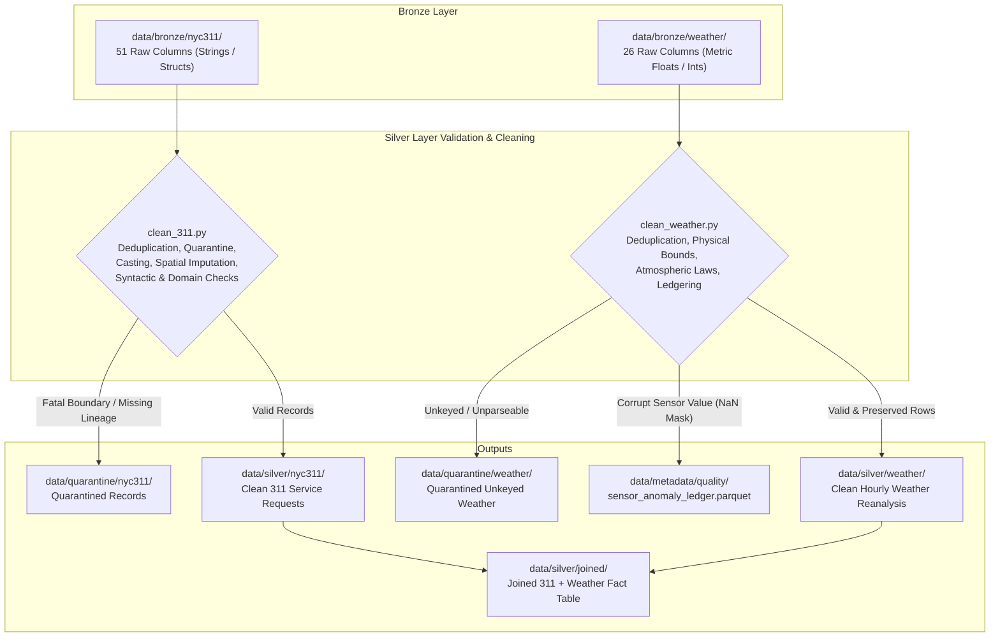

# Bronze to Silver Data Dictionary & Validation Matrix

This document provides a complete, column-by-column specification of all data transformations, type castings, physical and institutional validations, and anomaly handling mechanisms from the **Bronze** raw ingestion layer to the **Silver** cleaned and validated layer.

---

## 1. Architecture & Design Principles

1. **Lossless Ingestion (Bronze)**: Raw data is preserved as delivered by the upstream APIs (Socrata Open Data for 311, Open-Meteo ERA5-Land for Weather) with zero transformation, augmented with metadata lineage columns (`_batch_id`, `_ingested_at_utc`, `_source_file`, `_source_name`, `_extraction_mode`, `_schema_version`, `_raw_row_hash`).
2. **Strict Quarantining (Silver 311 & Weather)**: Fatal records (missing/non-numeric unique keys, negative resolution durations, pre-2003 epoch dates, future timestamps, missing/empty `_batch_id` lineage metadata, or unkeyed weather observations) are isolated to `data/quarantine/` without polluting downstream analytics.
3. **Syntactic vs. Soft Registry Agency Validation (Zero Data Loss)**:
   * **Syntactic Sanity**: Discards garbage (e.g. purely numeric strings like `"99999"`, strings $<2$ or $>10$ characters, or leaked addresses/descriptions).
   * **Soft Registry Tagging**: The 30+ official municipal agency acronyms from the 2025 Data Dictionary serve as an informational benchmark (`is_known_agency = True/False`). Legitimate unregistered or newly created task forces (e.g. `MOCJ`, `BPL`) are **never dropped or rejected**, but remain 100% intact with an informational audit note (`UNREGISTERED_AGENCY(...)`).
4. **Borough and Channel Domain Integrity**:
   * **Borough**: Validated against the 5 legal NYC boroughs (`MANHATTAN`, `BRONX`, `BROOKLYN`, `QUEENS`, `STATEN ISLAND`) plus `"UNSPECIFIED"`. Unrecognized boroughs are normalized to `"UNSPECIFIED"`, flagged in `is_valid_borough = False`, and logged in `quality_audit_notes`.
   * **Channel Type**: Standardized against `{"PHONE", "ONLINE", "MOBILE", "OTHER", "UNKNOWN"}`. Unrecognized channels are normalized to `"UNKNOWN"` and logged in `quality_audit_notes`.
5. **Zero-Information-Loss Sensor Ledgering (Silver Weather)**: Physical weather records are never deleted on sensor anomalies. Corrupt sensor fields are masked to `NaN`, while the exact raw value, violated rule, timestamp, and grid cell are logged in [`sensor_anomaly_ledger.parquet`](file:///C:/Media/UiS/DAT535/data/metadata/quality/sensor_anomaly_ledger.parquet) and the row's `quality_audit_notes`. Real extreme storms are preserved and tagged in `is_extreme_weather`.
6. **Join Cartesian Guard**: Deduplication on `["grid_id", "timestamp_utc"]` combined with a hard assertion `assert len(df_joined) == len(df_311)` prevents 1-to-many Cartesian multiplications during feature joins.

---

## 2. NYC 311 Service Requests: Column-by-Column Matrix

The raw Bronze dataset contains **51 columns**. The table below details the processing, type casting, validation criteria, and code locations for every single column.

| # | Bronze Column Name | Bronze Type (Raw) | Silver Target Name(s) | Silver Type (Casted) | Validation Criteria & Rules | Action on Failure | Code Reference Link |
|---|--------------------|-------------------|-----------------------|----------------------|-----------------------------|-------------------|---------------------|
| 1 | `unique_key` | `large_string` | `unique_key` | `Int64` (nullable) | Parsed as numeric; must be non-null and strictly positive ($> 0$). Unique constraint enforced via deduplication keeping latest `_ingested_at_utc`. | **Quarantined** (`INVALID_OR_NON_NUMERIC_UNIQUE_KEY`) | [clean_311.py#L116-L118](file:///C:/Media/UiS/DAT535/src/silver/clean_311.py#L116-L118), [clean_311.py#L164-L185](file:///C:/Media/UiS/DAT535/src/silver/clean_311.py#L164-L185), [clean_311.py#L215](file:///C:/Media/UiS/DAT535/src/silver/clean_311.py#L215) |
| 2 | `created_date` | `large_string` | `created_at_utc` | `timestamp[us, tz=UTC]` | Parsed from America/New_York local time to UTC. Must be non-null, $\ge \text{2003-03-01}$ (NYC 311 launch), and $\le \text{UTC now} + 2\text{h}$ (clock drift grace). | **Quarantined** (`MISSING_CREATED_TIMESTAMP`, `PRE_311_EPOCH_DATE`, or `FUTURE_CREATED_DATE`) | [clean_311.py#L52-L63](file:///C:/Media/UiS/DAT535/src/silver/clean_311.py#L52-L63), [clean_311.py#L124](file:///C:/Media/UiS/DAT535/src/silver/clean_311.py#L124), [clean_311.py#L171-L185](file:///C:/Media/UiS/DAT535/src/silver/clean_311.py#L171-L185) |
| 3 | `closed_date` | `large_string` | `closed_at_utc` | `timestamp[us, tz=UTC]` | Parsed from America/New_York local time to UTC. If present, resolution duration must be $\ge 0.0$ hours and $\le \text{UTC now} + 2\text{h}$. | **Quarantined** (`NEGATIVE_RESOLUTION_DURATION` or `FUTURE_CLOSED_DATE`) | [clean_311.py#L125-L129](file:///C:/Media/UiS/DAT535/src/silver/clean_311.py#L125-L129), [clean_311.py#L172](file:///C:/Media/UiS/DAT535/src/silver/clean_311.py#L172), [clean_311.py#L176](file:///C:/Media/UiS/DAT535/src/silver/clean_311.py#L176) |
| 4 | `agency` | `large_string` | `agency`, `is_known_agency` | `large_string`, `bool` | Stripped and upper-cased. **Syntactic check**: rejected if purely numeric (except `"311"`/`"3-1-1"`), length $<2$ or $>10$, or invalid characters. **Soft Registry check**: compared against 30+ official agencies (`KNOWN_NYC_AGENCIES`). | Malformed imputed to `"UNKNOWN"` (`MALFORMED_AGENCY`); legitimate unregistered agencies preserved with soft audit note (`UNREGISTERED_AGENCY`) | [clean_311.py#L324-L342](file:///C:/Media/UiS/DAT535/src/silver/clean_311.py#L324-L342), [clean_311.py#L400-L404](file:///C:/Media/UiS/DAT535/src/silver/clean_311.py#L400-L404), [config.py#L69-L108](file:///C:/Media/UiS/DAT535/src/silver/config.py#L69-L108) |
| 5 | `agency_name` | `large_string` | `agency_name` | `large_string` | Preserved as descriptive string; no validation required. | Pass-through intact | [clean_311.py#L106](file:///C:/Media/UiS/DAT535/src/silver/clean_311.py#L106) |
| 6 | `complaint_type` | `large_string` | `complaint_type` | `large_string` | Stripped, whitespace normalized, and converted to Title Case. Missing or literal `'nan'`/`'none'` imputed to `"Unknown"`. | Standardized & imputed | [clean_311.py#L66-L85](file:///C:/Media/UiS/DAT535/src/silver/clean_311.py#L66-L85), [clean_311.py#L309](file:///C:/Media/UiS/DAT535/src/silver/clean_311.py#L309) |
| 7 | `descriptor` | `large_string` | `descriptor` | `large_string` | Stripped; case preserved. Missing or literal stringified nulls imputed to `"Not Stated"`. | Standardized & imputed | [clean_311.py#L66-L85](file:///C:/Media/UiS/DAT535/src/silver/clean_311.py#L66-L85), [clean_311.py#L311](file:///C:/Media/UiS/DAT535/src/silver/clean_311.py#L311) |
| 8 | `location_type` | `large_string` | `location_type` | `large_string` | Preserved as descriptive string. | Pass-through intact | [clean_311.py#L106](file:///C:/Media/UiS/DAT535/src/silver/clean_311.py#L106) |
| 9 | `incident_zip` | `large_string` | `clean_incident_zip` | `large_string` (5-digit string) | Regex extracted `(\d{5})`. Preserved as zero-padded string (never integer, preventing leading zero loss on `"07030"`). Checked against `NYC_METRO_ZIP_PREFIXES`. Used as Level 2 spatial fallback. | Masked to `None` if invalid; flagged in `is_out_of_state_zip` if non-metro | [clean_311.py#L218-L231](file:///C:/Media/UiS/DAT535/src/silver/clean_311.py#L218-L231), [clean_311.py#L262-L275](file:///C:/Media/UiS/DAT535/src/silver/clean_311.py#L262-L275), [config.py#L130-L137](file:///C:/Media/UiS/DAT535/src/silver/config.py#L130-L137) |
| 10 | `incident_address` | `large_string` | `incident_address` | `large_string` | Preserved as descriptive string. | Pass-through intact | [clean_311.py#L106](file:///C:/Media/UiS/DAT535/src/silver/clean_311.py#L106) |
| 11 | `street_name` | `large_string` | `street_name` | `large_string` | Preserved as descriptive string. | Pass-through intact | [clean_311.py#L106](file:///C:/Media/UiS/DAT535/src/silver/clean_311.py#L106) |
| 12 | `cross_street_1` | `large_string` | `cross_street_1` | `large_string` | Preserved as descriptive string. | Pass-through intact | [clean_311.py#L106](file:///C:/Media/UiS/DAT535/src/silver/clean_311.py#L106) |
| 13 | `cross_street_2` | `large_string` | `cross_street_2` | `large_string` | Preserved as descriptive string. | Pass-through intact | [clean_311.py#L106](file:///C:/Media/UiS/DAT535/src/silver/clean_311.py#L106) |
| 14 | `intersection_street_1` | `large_string` | `intersection_street_1` | `large_string` | Preserved as descriptive string. | Pass-through intact | [clean_311.py#L106](file:///C:/Media/UiS/DAT535/src/silver/clean_311.py#L106) |
| 15 | `intersection_street_2` | `large_string` | `intersection_street_2` | `large_string` | Preserved as descriptive string. | Pass-through intact | [clean_311.py#L106](file:///C:/Media/UiS/DAT535/src/silver/clean_311.py#L106) |
| 16 | `address_type` | `large_string` | `address_type` | `large_string` | Preserved as descriptive string. | Pass-through intact | [clean_311.py#L106](file:///C:/Media/UiS/DAT535/src/silver/clean_311.py#L106) |
| 17 | `city` | `large_string` | `city` | `large_string` | Preserved as descriptive string. | Pass-through intact | [clean_311.py#L106](file:///C:/Media/UiS/DAT535/src/silver/clean_311.py#L106) |
| 18 | `landmark` | `large_string` | `landmark` | `large_string` | Preserved as descriptive string. | Pass-through intact | [clean_311.py#L106](file:///C:/Media/UiS/DAT535/src/silver/clean_311.py#L106) |
| 19 | `status` | `large_string` | `status` | `large_string` | Stripped and converted to uppercase. Validated against `KNOWN_311_STATUSES`. Cross-validated against `closed_at_utc` for bidirectional contradictions. | Unrecognized tagged in `quality_audit_notes` (`UNRECOGNIZED_STATUS`); contradiction flagged in `is_status_conflict` | [clean_311.py#L314-L321](file:///C:/Media/UiS/DAT535/src/silver/clean_311.py#L314-L321), [clean_311.py#L380-L394](file:///C:/Media/UiS/DAT535/src/silver/clean_311.py#L380-L394), [config.py#L122-L132](file:///C:/Media/UiS/DAT535/src/silver/config.py#L122-L132) |
| 20 | `resolution_description` | `large_string` | `resolution_description` | `large_string` | Preserved as descriptive text. | Pass-through intact | [clean_311.py#L106](file:///C:/Media/UiS/DAT535/src/silver/clean_311.py#L106) |
| 21 | `resolution_action_updated_date` | `large_string` | `resolution_action_updated_date_utc` | `timestamp[us, tz=UTC]` | Parsed from America/New_York local time to UTC. | Converted to `NaT` if missing or unparseable | [clean_311.py#L373-L374](file:///C:/Media/UiS/DAT535/src/silver/clean_311.py#L373-L374) |
| 22 | `community_board` | `large_string` | `community_board` | `large_string` | Preserved as descriptive string. | Pass-through intact | [clean_311.py#L106](file:///C:/Media/UiS/DAT535/src/silver/clean_311.py#L106) |
| 23 | `council_district` | `large_string` | `council_district` | `Int16` (nullable) | Converted to numeric; validated strictly against legal NYC Charter bounds $[1, 51]$. Values outside $1\text{–}51$ are corrupt artifacts. | Masked to `NaN` / `pd.NA` | [clean_311.py#L358-L361](file:///C:/Media/UiS/DAT535/src/silver/clean_311.py#L358-L361), [config.py#L65-L66](file:///C:/Media/UiS/DAT535/src/silver/config.py#L65-L66) |
| 24 | `police_precinct` | `large_string` | `clean_police_precinct` | `Int16` (nullable) | Regex extracted digits; validated against active NYPD precinct bounds $[1, 123]$ (NYC has 77 precincts numbered up to 123). | Masked to `NaN` / `pd.NA` | [clean_311.py#L364-L368](file:///C:/Media/UiS/DAT535/src/silver/clean_311.py#L364-L368) |
| 25 | `bbl` | `large_string` | `bbl` | `large_string` | Borough-Block-Lot 10-digit tax parcel identifier. Preserved as string. | Pass-through intact | [clean_311.py#L106](file:///C:/Media/UiS/DAT535/src/silver/clean_311.py#L106) |
| 26 | `borough` | `large_string` | `borough`, `is_valid_borough` | `large_string`, `bool` | Upper-cased and stripped. Validated against `VALID_NYC_BOROUGHS` (`{"MANHATTAN", "BRONX", "BROOKLYN", "QUEENS", "STATEN ISLAND", "UNSPECIFIED"}`). | Unrecognized normalized to `"UNSPECIFIED"`, flagged in `is_valid_borough = False`, and logged as `UNRECOGNIZED_BOROUGH(...)` | [clean_311.py#L296-L306](file:///C:/Media/UiS/DAT535/src/silver/clean_311.py#L296-L306), [clean_311.py#L427](file:///C:/Media/UiS/DAT535/src/silver/clean_311.py#L427), [config.py#L55-L63](file:///C:/Media/UiS/DAT535/src/silver/config.py#L55-L63) |
| 27 | `x_coordinate_state_plane` | `large_string` | `x_coordinate_state_plane` | `double` | Converted to numeric; validated against EPSG:2263 NY Long Island State Plane bounds $[900,000.0, 1,075,000.0]$ US Survey Feet. | Masked to `NaN` | [clean_311.py#L346-L352](file:///C:/Media/UiS/DAT535/src/silver/clean_311.py#L346-L352), [config.py#L34-L39](file:///C:/Media/UiS/DAT535/src/silver/config.py#L34-L39) |
| 28 | `y_coordinate_state_plane` | `large_string` | `y_coordinate_state_plane` | `double` | Converted to numeric; validated against EPSG:2263 NY Long Island State Plane bounds $[110,000.0, 285,000.0]$ US Survey Feet. | Masked to `NaN` | [clean_311.py#L353-L359](file:///C:/Media/UiS/DAT535/src/silver/clean_311.py#L353-L359), [config.py#L34-L39](file:///C:/Media/UiS/DAT535/src/silver/config.py#L34-L39) |
| 29 | `open_data_channel_type` | `large_string` | `open_data_channel_type` | `large_string` | Stripped and upper-cased. Validated against `VALID_OPEN_DATA_CHANNELS` (`{"PHONE", "ONLINE", "MOBILE", "OTHER", "UNKNOWN"}`). | Unrecognized normalized to `"UNKNOWN"` and logged as `UNRECOGNIZED_CHANNEL(...)` | [clean_311.py#L344-L351](file:///C:/Media/UiS/DAT535/src/silver/clean_311.py#L344-L351), [config.py#L112-L119](file:///C:/Media/UiS/DAT535/src/silver/config.py#L112-L119) |
| 30 | `park_facility_name` | `large_string` | `park_facility_name` | `large_string` | Preserved as descriptive string. | Pass-through intact | [clean_311.py#L106](file:///C:/Media/UiS/DAT535/src/silver/clean_311.py#L106) |
| 31 | `park_borough` | `large_string` | `park_borough` | `large_string` | Preserved as descriptive string. | Pass-through intact | [clean_311.py#L106](file:///C:/Media/UiS/DAT535/src/silver/clean_311.py#L106) |
| 32 | `latitude` | `large_string` | `latitude`, `clean_latitude` | `double` | Parsed to numeric. Tested against NYC geographic bounding box $[40.48, 40.95]$. If valid, used for Level 1 exact coordinate assignment. | If invalid/null, triggers Level 2 (ZIP) or Level 3 (Borough) fallback | [clean_311.py#L235](file:///C:/Media/UiS/DAT535/src/silver/clean_311.py#L235), [clean_311.py#L239-L256](file:///C:/Media/UiS/DAT535/src/silver/clean_311.py#L239-L256), [clean_311.py#L342](file:///C:/Media/UiS/DAT535/src/silver/clean_311.py#L342) |
| 33 | `longitude` | `large_string` | `longitude`, `clean_longitude` | `double` | Parsed to numeric. Tested against NYC geographic bounding box $[-74.28, -73.65]$. If valid, used for Level 1 exact coordinate assignment. | If invalid/null, triggers Level 2 (ZIP) or Level 3 (Borough) fallback | [clean_311.py#L236](file:///C:/Media/UiS/DAT535/src/silver/clean_311.py#L236), [clean_311.py#L239-L256](file:///C:/Media/UiS/DAT535/src/silver/clean_311.py#L239-L256), [clean_311.py#L343](file:///C:/Media/UiS/DAT535/src/silver/clean_311.py#L343) |
| 34 | `location` | `struct<type, coordinates>` | `location` | `struct<type, coordinates>` | Native Socrata GeoJSON geometry struct. Preserved intact for GIS workflows. | Pass-through intact | [clean_311.py#L106](file:///C:/Media/UiS/DAT535/src/silver/clean_311.py#L106) |
| 35 | `descriptor_2` | `large_string` | `descriptor_2` | `large_string` | Secondary descriptor field. Preserved as string. | Pass-through intact | [clean_311.py#L106](file:///C:/Media/UiS/DAT535/src/silver/clean_311.py#L106) |
| 36 | `vehicle_type` | `large_string` | `vehicle_type` | `large_string` | Descriptive metadata. Preserved as string. | Pass-through intact | [clean_311.py#L106](file:///C:/Media/UiS/DAT535/src/silver/clean_311.py#L106) |
| 37 | `taxi_pick_up_location` | `large_string` | `taxi_pick_up_location` | `large_string` | Descriptive metadata. Preserved as string. | Pass-through intact | [clean_311.py#L106](file:///C:/Media/UiS/DAT535/src/silver/clean_311.py#L106) |
| 38 | `facility_type` | `large_string` | `facility_type` | `large_string` | Descriptive metadata. Preserved as string. | Pass-through intact | [clean_311.py#L106](file:///C:/Media/UiS/DAT535/src/silver/clean_311.py#L106) |
| 39 | `bridge_highway_name` | `large_string` | `bridge_highway_name` | `large_string` | Descriptive metadata. Preserved as string. | Pass-through intact | [clean_311.py#L106](file:///C:/Media/UiS/DAT535/src/silver/clean_311.py#L106) |
| 40 | `bridge_highway_direction` | `large_string` | `bridge_highway_direction` | `large_string` | Descriptive metadata. Preserved as string. | Pass-through intact | [clean_311.py#L106](file:///C:/Media/UiS/DAT535/src/silver/clean_311.py#L106) |
| 41 | `road_ramp` | `large_string` | `road_ramp` | `large_string` | Descriptive metadata. Preserved as string. | Pass-through intact | [clean_311.py#L106](file:///C:/Media/UiS/DAT535/src/silver/clean_311.py#L106) |
| 42 | `bridge_highway_segment` | `large_string` | `bridge_highway_segment` | `large_string` | Descriptive metadata. Preserved as string. | Pass-through intact | [clean_311.py#L106](file:///C:/Media/UiS/DAT535/src/silver/clean_311.py#L106) |
| 43 | `due_date` | `large_string` | `due_date_utc` | `timestamp[us, tz=UTC]` | Target SLA resolution date. Parsed to UTC. | Converted to `NaT` if missing or unparseable | [clean_311.py#L371-L372](file:///C:/Media/UiS/DAT535/src/silver/clean_311.py#L371-L372) |
| 44 | `taxi_company_borough` | `large_string` | `taxi_company_borough` | `large_string` | Descriptive metadata. Preserved as string. | Pass-through intact | [clean_311.py#L106](file:///C:/Media/UiS/DAT535/src/silver/clean_311.py#L106) |
| 45 | `_batch_id` | `large_string` | `_batch_id` | `large_string` | Ingestion batch UUID. Validated: must not be null, empty, or whitespace. | **Quarantined** (`CORRUPTED_INGESTION_METADATA`) | [clean_311.py#L177-L185](file:///C:/Media/UiS/DAT535/src/silver/clean_311.py#L177-L185) |
| 46 | `_ingested_at_utc` | `large_string` | `_ingested_at_utc` | `large_string` | Ingestion UTC timestamp. Used for deterministic deduplication order (latest wins). | Pass-through intact | [clean_311.py#L111-L115](file:///C:/Media/UiS/DAT535/src/silver/clean_311.py#L111-L115) |
| 47 | `_source_file` | `large_string` | `_source_file` | `large_string` | Bronze origin file path. Preserved for audit trail. | Pass-through intact | [clean_311.py#L106](file:///C:/Media/UiS/DAT535/src/silver/clean_311.py#L106) |
| 48 | `_source_name` | `large_string` | `_source_name` | `large_string` | Source identifier (`nyc311`). Preserved. | Pass-through intact | [clean_311.py#L106](file:///C:/Media/UiS/DAT535/src/silver/clean_311.py#L106) |
| 49 | `_extraction_mode` | `large_string` | `_extraction_mode` | `large_string` | Extraction mode (`incremental` / `backfill`). Preserved. | Pass-through intact | [clean_311.py#L106](file:///C:/Media/UiS/DAT535/src/silver/clean_311.py#L106) |
| 50 | `_schema_version` | `large_string` | `_schema_version` | `large_string` | Bronze schema contract version. Preserved. | Pass-through intact | [clean_311.py#L106](file:///C:/Media/UiS/DAT535/src/silver/clean_311.py#L106) |
| 51 | `_raw_row_hash` | `large_string` | `_raw_row_hash` | `large_string` | SHA-256 hash of raw JSON record. Preserved. | Pass-through intact | [clean_311.py#L106](file:///C:/Media/UiS/DAT535/src/silver/clean_311.py#L106) |

---

## 3. Open-Meteo Weather Reanalysis: Column-by-Column Matrix

The raw Bronze weather dataset contains **26 columns**.

| # | Bronze Column Name | Bronze Type (Raw) | Silver Target Name | Silver Type (Casted) | Physical / Meteorological Validation Rule | Action on Failure | Code Reference Link |
|---|--------------------|-------------------|--------------------|----------------------|-------------------------------------------|-------------------|---------------------|
| 1 | `time` | `large_string` | `timestamp_utc` | `timestamp[us, tz=UTC]` | Parsed as ISO 8601 UTC timestamp. Unparseable or missing timestamps are unkeyed. Composite primary key with `grid_id`. | Quarantined to `quarantined_weather.parquet` | [clean_weather.py#L60-L101](file:///C:/Media/UiS/DAT535/src/silver/clean_weather.py#L60-L101) |
| 2 | `temperature_2m` | `double` | `temperature_2m` | `double` | Tested against NYC physical climate limits $[-35.0^\circ\text{C}, 45.0^\circ\text{C}]$ (NCEI Central Park all-time records: $-26.1^\circ\text{C}$ to $41.1^\circ\text{C}$). Soft-tagged if $<-25^\circ\text{C}$ or $>40^\circ\text{C}$. | Masked to `NaN` & logged to Anomaly Ledger if out of hard bounds | [clean_weather.py#L125-L135](file:///C:/Media/UiS/DAT535/src/silver/clean_weather.py#L125-L135), [config.py#L155-L159](file:///C:/Media/UiS/DAT535/src/silver/config.py#L155-L159) |
| 3 | `relative_humidity_2m` | `int64` | `relative_humidity_2m` | `Int16` (nullable) | Tested against physical relative humidity percentage limits $[0\%, 100\%]$. Cast to nullable `Int16`. | Masked to `NaN` & logged to Anomaly Ledger if out of bounds | [clean_weather.py#L165-L175](file:///C:/Media/UiS/DAT535/src/silver/clean_weather.py#L165-L175), [config.py#L166-L167](file:///C:/Media/UiS/DAT535/src/silver/config.py#L166-L167) |
| 4 | `dew_point_2m` | `double` | `dew_point_2m` | `double` | Atmospheric Thermodynamic Law (Clausius-Clapeyron): Dew point physically cannot exceed ambient dry-bulb temperature ($\text{dew\_point} \le \text{temperature} + 0.1^\circ\text{C}$). | Masked to `NaN` & logged to Anomaly Ledger (`DEW_POINT_EXCEEDS_TEMPERATURE`) | [clean_weather.py#L148-L163](file:///C:/Media/UiS/DAT535/src/silver/clean_weather.py#L148-L163) |
| 5 | `apparent_temperature` | `double` | `apparent_temperature` | `double` | Tested against wind chill / heat index physical bounds $[-45.0^\circ\text{C}, 55.0^\circ\text{C}]$. | Masked to `NaN` & logged to Anomaly Ledger if out of bounds | [clean_weather.py#L137-L146](file:///C:/Media/UiS/DAT535/src/silver/clean_weather.py#L137-L146), [config.py#L158-L159](file:///C:/Media/UiS/DAT535/src/silver/config.py#L158-L159) |
| 6 | `precipitation` | `double` | `precipitation` | `double` | Tested against non-negative constraint and world record hourly rainfall limit $[0.0, 150.0\text{ mm/hr}]$. Soft-tagged if $\ge 25.0\text{ mm/hr}$ (flash flood rate). | Masked to `NaN` & logged to Anomaly Ledger if out of bounds | [clean_weather.py#L177-L188](file:///C:/Media/UiS/DAT535/src/silver/clean_weather.py#L177-L188), [config.py#L160-L161](file:///C:/Media/UiS/DAT535/src/silver/config.py#L160-L161) |
| 7 | `rain` | `double` | `rain` | `double` | Mass Conservation: liquid rain must be $\ge 0.0\text{ mm}$ and cannot exceed total precipitation ($\text{rain} \le \text{precipitation} + 0.05\text{ mm}$). | Masked to `NaN` & logged to Anomaly Ledger (`RAIN_EXCEEDS_TOTAL_PRECIP`) | [clean_weather.py#L190-L202](file:///C:/Media/UiS/DAT535/src/silver/clean_weather.py#L190-L202) |
| 8 | `snowfall` | `double` | `snowfall` | `double` | Non-negative constraint ($\text{snowfall} \ge 0.0\text{ cm}$). | Masked to `NaN` & logged to Anomaly Ledger (`NEGATIVE_SNOWFALL`) | [clean_weather.py#L204-L207](file:///C:/Media/UiS/DAT535/src/silver/clean_weather.py#L204-L207) |
| 9 | `snow_depth` | `double` | `snow_depth` | `double` | Non-negative constraint ($\text{snow\_depth} \ge 0.0\text{ m}$). | Masked to `NaN` & logged to Anomaly Ledger (`NEGATIVE_SNOW_DEPTH`) | [clean_weather.py#L209-L211](file:///C:/Media/UiS/DAT535/src/silver/clean_weather.py#L209-L211) |
| 10 | `weather_code` | `int64` | `weather_code` | `Int16` (nullable) | Validated against official discrete codes in World Meteorological Organization (WMO) Code Table 4677 ($0, 1, 2, 3, 45, 48, 51, \dots$). Cast to nullable `Int16`. | Masked to `NaN` & logged to Anomaly Ledger (`INVALID_WMO_WEATHER_CODE`) | [clean_weather.py#L265-L273](file:///C:/Media/UiS/DAT535/src/silver/clean_weather.py#L265-L273), [config.py#L146-L149](file:///C:/Media/UiS/DAT535/src/silver/config.py#L146-L149) |
| 11 | `surface_pressure` | `double` | `surface_pressure` | `double` | Tested against global terrestrial barometric limits $[870.0, 1085.0\text{ hPa}]$ (Typhoon Tip: $870\text{ hPa}$, Siberian High: $1084\text{ hPa}$). | Masked to `NaN` & logged to Anomaly Ledger (`SURFACE_PRESSURE_OUT_OF_BOUNDS`) | [clean_weather.py#L253-L263](file:///C:/Media/UiS/DAT535/src/silver/clean_weather.py#L253-L263), [config.py#L164-L165](file:///C:/Media/UiS/DAT535/src/silver/config.py#L164-L165) |
| 12 | `wind_speed_10m` | `double` | `wind_speed_10m` | `double` | Tested against physical sustained wind bounds $[0.0, 65.0\text{ m/s}]$ ($65\text{ m/s} \approx 234\text{ km/h}$, Category 5 hurricane force). | Masked to `NaN` & logged to Anomaly Ledger (`WIND_SPEED_OUT_OF_BOUNDS`) | [clean_weather.py#L213-L223](file:///C:/Media/UiS/DAT535/src/silver/clean_weather.py#L213-L223), [config.py#L162-L163](file:///C:/Media/UiS/DAT535/src/silver/config.py#L162-L163) |
| 13 | `wind_gusts_10m` | `double` | `wind_gusts_10m` | `double` | Aerodynamic Law (AMS Glossary): 3-second peak gust physically cannot be slower than 1-hour sustained wind ($\text{gust} \ge \text{wind\_speed} - 0.01\text{ m/s}$). Soft-tagged if $\ge 22.2\text{ m/s}$ ($80\text{ km/h}$ severe storm). | Masked to `NaN` & logged to Anomaly Ledger (`GUST_LESS_THAN_SUSTAINED_SPEED`) | [clean_weather.py#L226-L239](file:///C:/Media/UiS/DAT535/src/silver/clean_weather.py#L226-L239), [config.py#L188](file:///C:/Media/UiS/DAT535/src/silver/config.py#L188) |
| 14 | `wind_direction_10m` | `int64` | `wind_direction_10m` | `Int16` (nullable) | Compass azimuth bounds $[0^\circ, 360^\circ]$. Cast to nullable `Int16`. | Masked to `NaN` & logged to Anomaly Ledger (`WIND_DIRECTION_OUT_OF_BOUNDS`) | [clean_weather.py#L241-L251](file:///C:/Media/UiS/DAT535/src/silver/clean_weather.py#L241-L251), [config.py#L168-L169](file:///C:/Media/UiS/DAT535/src/silver/config.py#L168-L169) |
| 15 | `grid_id` | `large_string` | `grid_id` | `large_string` | Unique cell identifier (e.g. `GRID_40.7_-74.0`). Must not be null or empty. | Quarantined to `quarantined_weather.parquet` | [clean_weather.py#L65-L70](file:///C:/Media/UiS/DAT535/src/silver/clean_weather.py#L65-L70), [clean_weather.py#L98](file:///C:/Media/UiS/DAT535/src/silver/clean_weather.py#L98) |
| 16 | `grid_lat` | `double` | `grid_lat` | `double` | ERA5-Land model grid latitude ($0.1^\circ$ spacing). Preserved intact. | Pass-through intact | [clean_weather.py#L55](file:///C:/Media/UiS/DAT535/src/silver/clean_weather.py#L55) |
| 17 | `grid_lon` | `double` | `grid_lon` | `double` | ERA5-Land model grid longitude ($0.1^\circ$ spacing). Preserved intact. | Pass-through intact | [clean_weather.py#L55](file:///C:/Media/UiS/DAT535/src/silver/clean_weather.py#L55) |
| 18 | `borough_hint` | `large_string` | `borough_hint` | `large_string` | NYC borough nearest to grid centroid. Preserved intact. | Pass-through intact | [clean_weather.py#L55](file:///C:/Media/UiS/DAT535/src/silver/clean_weather.py#L55) |
| 19 | `model_elevation` | `double` | `model_elevation` | `double` | Digital elevation model height in meters above sea level. Preserved intact. | Pass-through intact | [clean_weather.py#L55](file:///C:/Media/UiS/DAT535/src/silver/clean_weather.py#L55) |
| 20 | `_batch_id` | `large_string` | `_batch_id` | `large_string` | Ingestion batch UUID. Validated: must not be null or empty. | Quarantined (`CORRUPTED_INGESTION_METADATA`) | [clean_weather.py#L79-L95](file:///C:/Media/UiS/DAT535/src/silver/clean_weather.py#L79-L95) |
| 21 | `_ingested_at_utc` | `large_string` | `_ingested_at_utc` | `large_string` | Ingestion UTC timestamp. Used for deterministic deduplication order (latest wins). | Pass-through intact | [clean_weather.py#L106-L109](file:///C:/Media/UiS/DAT535/src/silver/clean_weather.py#L106-L109) |
| 22 | `_source_file` | `large_string` | `_source_file` | `large_string` | Bronze origin file path. Preserved for audit trail. | Pass-through intact | [clean_weather.py#L55](file:///C:/Media/UiS/DAT535/src/silver/clean_weather.py#L55) |
| 23 | `_source_name` | `large_string` | `_source_name` | `large_string` | Source identifier (`open_meteo_archive`). Preserved. | Pass-through intact | [clean_weather.py#L55](file:///C:/Media/UiS/DAT535/src/silver/clean_weather.py#L55) |
| 24 | `_extraction_mode` | `large_string` | `_extraction_mode` | `large_string` | Extraction mode (`incremental` / `backfill`). Preserved. | Pass-through intact | [clean_weather.py#L55](file:///C:/Media/UiS/DAT535/src/silver/clean_weather.py#L55) |
| 25 | `_schema_version` | `large_string` | `_schema_version` | `large_string` | Bronze schema contract version. Preserved. | Pass-through intact | [clean_weather.py#L55](file:///C:/Media/UiS/DAT535/src/silver/clean_weather.py#L55) |
| 26 | `_raw_row_hash` | `large_string` | `_raw_row_hash` | `large_string` | SHA-256 hash of raw JSON record. Preserved. | Pass-through intact | [clean_weather.py#L55](file:///C:/Media/UiS/DAT535/src/silver/clean_weather.py#L55) |
