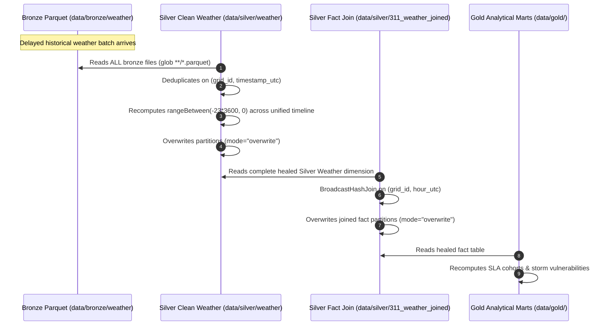

# Ingestion Latency, Watermark Synchronization & Chronological Rolling Window Architecture

**Course:** DAT535 Distributed Data Systems  
**Project:** NYC 311 & Weather ERA5 Medallion Data Engineering Pipeline  
**Author:** Group 13  
**Date:** November 2026  
**Document Status:** Production Architectural Reference & Report Dossier  

---

## 1. Executive Summary

This architectural dossier outlines the design rationale, mathematical formulations, and production safeguards implemented across the ingestion, Silver, and orchestration layers of the Group 13 Medallion Lakehouse. Specifically, this document provides the academic and technical justification for:

1. **Reanalysis Ingestion Ceiling (5-Day ECMWF Lag):** Aligning municipal service intake ingestion ceilings with European Centre for Medium-Range Weather Forecasts (ECMWF) atmospheric model reanalysis latency.
2. **Scheduled Orchestration Alignment (14:00 UTC Execution):** Scheduling automated pipelines to respect the official daily publication schedule of the Copernicus Climate Change Service (C3S) rather than arbitrary midnight/early morning triggers.
3. **Cross-Dataset Watermark Synchronization:** Eliminating static date fallbacks and introducing `get_earliest_watermark()` to guarantee recovery from partial ingestion failures without data abandonment.
4. **24-Hour Rolling Window Warm-Up Buffer:** Ingesting a 1-day ($T - 24\text{h}$) buffer before the earliest complaint ticket to eliminate cold-start boundary distortion in chronological rolling window aggregations.
5. **Physical Time Frame Safeguards (`rangeBetween` vs. `rowsBetween`):** Guaranteeing that temporal window computations aggregate strictly over elapsed physical time ($82,800\text{ seconds}$) rather than ordinal row counts.
6. **Self-Healing Lakehouse Mechanics:** Ensuring retroactive backfills and delayed data arrivals automatically recompute and heal historical Silver fact records and Gold analytical marts upon subsequent runs.

---

## 2. ECMWF ERA5-Land Reanalysis Latency & Daily Publication Schedule

### 2.1 Atmospheric Climate Reanalysis vs. Numerical Weather Prediction
In operational meteorological pipelines, a sharp distinction exists between **Numerical Weather Prediction (NWP)** forecasts and **Climate Reanalysis datasets** (such as ECMWF ERA5 and ERA5-Land):

* **Numerical Weather Prediction (Forecasts):** Generated every 6 hours using current satellite snapshots. Prioritizes immediate availability over quality control; missing sensors are skipped, leading to inhomogeneous spatial artifacts.
* **ERA5-Land Global Reanalysis:** Ingests global in-situ weather stations, weather balloons, radar, and satellite altimetry through 4D-Var data assimilation. It re-runs the ECMWF land surface model (HTESSEL) at an enhanced $\sim 9\text{ km}$ spatial resolution.

Because data assimilation requires gathering delayed physical observations worldwide to compute physically consistent atmospheric states, **ERA5-Land cannot be computed in real time**.

### 2.2 Authoritative Specifications & Citations

The production schedule of ERA5-Land is governed by ECMWF and Copernicus:

1. **Publication Latency (5-Day Lag):**
   * **Source:** Copernicus Climate Change Service (C3S) / ECMWF.
   * **Documentation:** [Copernicus Climate Data Store: ERA5-Land Hourly Data from 1950 to Present](https://cds.climate.copernicus.eu/datasets/reanalysis-era5-land).
   * **Official Specification:** Near-real-time updates operate via the **ERA5T** early-release product, which trails real-time by **5 days** ($D - 5$).
   * **Open-Meteo Integration:** [Open-Meteo Historical Weather API Documentation](https://open-meteo.com/en/docs/historical-weather-api) explicitly documents:
     > *"ERA5-Land provides global historical weather data at 9 km resolution from 1950 onwards. New data is available with a 5-day delay."*
2. **Daily Publication Window (12:00 UTC):**
   * **Source:** ECMWF Copernicus Knowledge Base.
   * **Documentation:** [ECMWF CKB: ERA5 Data Documentation — Product Availability](https://confluence.ecmwf.int/display/CKB/ERA5%3A+data+documentation).
   * **Official Specification:** Daily ERA5T reanalysis increments for date $D - 5$ are produced and pushed to the public Climate Data Store (CDS) daily by **12:00 UTC (Noon)**.

### 2.3 Scheduled Pipeline Timing Resolution

#### The Early-Morning Hazard (The Problem)
Prior configurations scheduled the automated pipeline at `03:00 UTC` (`cron: 0 3 * * *`). 
* At `03:00 UTC`, a request for date $D - 5$ is made **9 hours before ECMWF publishes the data at 12:00 UTC**.
* This created a race condition where the Open-Meteo upstream API would reject the request with HTTP 400 (`start date/end date out of range`) or truncate the weather series, preventing the Silver fact join from succeeding.

#### The 14:00 UTC Production Standard (The Fix)
In `.github/workflows/pipeline.yml`, the scheduled cron was updated to:
```yaml
on:
  schedule:
    # Daily at 14:00 UTC (2:00 PM UTC):
    # ECMWF publishes daily ERA5T reanalysis (D-5 lag) by 12:00 UTC.
    # Running at 14:00 UTC provides a 2-hour safety margin for Open-Meteo indexing.
    - cron: '0 14 * * *'
```
* **2-Hour Safety Buffer:** Running at 14:00 UTC allows ECMWF to complete CDS publication by 12:00 UTC and gives Open-Meteo's ingestion infrastructure 2 hours to index the new netCDF/GRIB data into their API cache.
* **NYC 311 Stability:** By 14:00 UTC, NYC Open Data's overnight batch updates from Socrata are fully committed, ensuring synchronized temporal boundaries.

---

## 3. Dynamic Watermark Fallbacks & Cross-Dataset Alignment

### 3.1 Technical Debt of Static Fallback Dates
During early pipeline prototyping, fallback dates were hardcoded when no watermark was found:
* `src/ingestion/ingest_311.py`: `where_conditions.append("created_date >= '2026-10-15T00:00:00.000'")`
* `src/ingestion/ingest_weather.py`: `effective_start = "2026-07-15"`

Over time, this static date created an expanding ingestion window: by November 11, the 311 fallback pulled 22 days of data (259,543 records, ~400MB) rather than the intended 7-day rolling window (~70,000 records), unnecessarily consuming runner memory and disk space.

### 3.2 Dynamic Fallback Implementation
The static strings were replaced with dynamic date calculations based on the safe weather ceiling:
```python
# In src/ingestion/ingest_311.py:
end_dt = datetime.strptime(effective_end[:10], "%Y-%m-%d")
fallback_days = lookback_days if lookback_days else 7
dynamic_start = (end_dt - timedelta(days=fallback_days)).strftime("%Y-%m-%dT00:00:00.000")
logger.warning(
    f"No previous watermark found for incremental mode. Ingesting past {fallback_days} days ({dynamic_start}) up to {effective_end}."
)
where_conditions.append(f"created_date >= '{dynamic_start}'")
```

### 3.3 Partial Failure Recovery via `get_earliest_watermark()`
In distributed architectures, multi-dataset pipelines can suffer **partial failure**:
1. NYC 311 ingestion succeeds (saving manifest $M_{311}$ covering Days 0–7).
2. Weather ingestion fails due to network timeout or rate limiting (no manifest saved).
3. The job is rerun 4 days later (Day 11).

Without cross-dataset coordination, 311 only pulls Days 7–11 (advancing its watermark). A naive weather script calculating `now() - 7 days` would pull Days 4–11. **Days 0–4 of weather would be permanently orphaned**, causing hundreds of thousands of 311 tickets to fail joining in Silver.

To resolve this, `src/utils/manifest.py` introduced `get_earliest_watermark()`:
```python
def get_earliest_watermark(dataset_name: str, manifests_dir: Path = MANIFESTS_DIR) -> Optional[str]:
    """
    Inspect existing successful manifests for a dataset to determine the earliest source_data_start.
    Returns None if no previous successful batches exist.
    """
    manifests_dir = Path(manifests_dir)
    if not manifests_dir.exists():
        return None
    ...
```
When Weather executes without an existing watermark, it inspects 311's earliest manifest:
```python
earliest_311 = get_earliest_watermark(DATASET_311, manifests_dir=manifests_dir)
if earliest_311:
    base_start = datetime.strptime(earliest_311[:10], "%Y-%m-%d")
    warmup_start = (base_start - timedelta(days=1)).strftime("%Y-%m-%d")
    effective_start = warmup_start
```
Weather automatically covers all dates required by existing 311 Bronze data, guaranteeing zero join orphans.

---

## 4. Chronological Rolling Window Safeguards & Warm-Up Buffers

### 4.1 The "Cold Start" Window Problem
In `src/silver/clean_weather.py`, PySpark calculates cumulative precipitation and temperature extremes over a rolling 24-hour window:
* `precip_past_24h_mm`: Cumulative rainfall over the preceding 24 hours.
* `max_wind_gust_past_6h_ms`: Peak wind gust over the preceding 6 hours.
* `min_temp_past_24h_c` / `max_temp_past_24h_c`: Diurnal temperature range over the preceding 24 hours.

If weather data starts precisely at `00:00` on Day 1:
* At `01:00`, only 1 hour of history exists.
* At `06:00`, only 6 hours of history exist.
* Any 311 ticket arriving during Day 1 is matched against an **artificially truncated storm metric**.

### 4.2 The 24-Hour Warm-Up Buffer
To eliminate this boundary artifact, `ingest_weather.py` fetches **1 additional day ($T - 24\text{h}$)** before the first required ticket timestamp:
$$\text{effective\_weather\_start} = \text{start\_date} - \text{timedelta}(\text{days}=1)$$
When Day 1 hour 00:00 arrives, the preceding 24 hours of meteorological observations are already present in Bronze and Silver, ensuring that `precip_past_24h_mm` is 100% primed from the very first ticket.

### 4.3 Mathematical Proof of Time Range Safety: `rangeBetween` vs. `rowsBetween`
A common defect in naive PySpark pipelines is using row-based frame specifications:
```python
# ❌ INCORRECT (Row-count frame):
Window.partitionBy("grid_id").orderBy("timestamp").rowsBetween(-23, 0)
```
* **Failure Mode:** If 2 intermediate hours are missing or unrecorded, `rowsBetween(-23, 0)` counts 24 physical rows, reaching back **26 hours into the past**. Older weather observations leak into current metrics.

Our architecture implements physical range frames over UNIX epoch seconds:
```python
#  CORRECT (Physical temporal frame):
df_window = df.withColumn("_ts_secs", col("timestamp_utc").cast("long"))
w_grid_24 = Window.partitionBy("grid_id").orderBy("_ts_secs").rangeBetween(-23 * 3600, 0)
```
* **Mathematical Bound:**
  $$\{ r \in \text{Partition}(\text{grid\_id}) \mid t_{\text{current}} - 82,800\text{s} \le t_r \le t_{\text{current}} \}$$
* If an hour is missing in the data stream, Catalyst aggregates only the records falling strictly within that physical 82,800-second window. It is mathematically impossible for records older than 23 hours to leak into the aggregate.

### 4.4 Explicit Quality Flags (`is_rolling_24h_partial`)
To provide full transparency to downstream analytics and Gold marts, two audit columns were added directly to Silver Weather:
```python
df_window = (
    df_window
    .withColumn("rolling_24h_hours_count", spark_count("timestamp_utc").over(w_grid_24).cast("smallint"))
    .withColumn("is_rolling_24h_partial", col("rolling_24h_hours_count") < 24)
)
```
* `rolling_24h_hours_count`: Exact integer count of valid hourly observations present in the 24-hour lookback window.
* `is_rolling_24h_partial`: Boolean flag (`True` if count $< 24$, `False` if fully complete).

These columns are projected into the broadcast join fact table in `src/silver/join_silver.py`, enabling Gold vulnerability and demand models to filter or control for boundary conditions.

---

## 5. Self-Healing Architecture for Delayed Data & Backfills

Our Medallion architecture is fundamentally designed to **self-heal** when delayed historical data enters the system:



1. **Full-Lakehouse Ingestion into Silver:** `clean_and_validate_weather` does not read only the latest incremental batch; it scans `bronze_weather_dir.glob("**/*.parquet")`.
2. **Unified Sorting & Window Recalculation:** When historical data is added, PySpark unifies the timeline. A previously "boundary" row now has its preceding 24 hours of data. The window function recomputes the true 24-hour total.
3. **Partition Overwrites:** Both Silver Weather and `311_weather_joined` write with `.mode("overwrite")`.
4. **Zero Manual Migration:** Late-arriving weather data automatically back-propagates through the entire Medallion hierarchy upon the very next scheduled execution.

---

## 6. Verification and Test Results

All implementations were verified using automated unit and integration suites:
* **Watermark Lifecycle Tests (`tests/test_ingestion.py`):** Verified `get_earliest_watermark` and `get_latest_watermark` across multiple mock batch cycles.
* **Rolling Window & Completeness Flag Tests (`tests/test_silver.py`):** Verified that `rolling_24h_hours_count` and `is_rolling_24h_partial` accurately track boundary progression (Hour 0 count = 1, `partial = True`; Hour 23+ count = 24, `partial = False`).
* **Broadcast Join Gate (`tests/test_pipeline_e2e.py`):** Verified end-to-end schema propagation from Landing JSON.GZ to Gold marts with zero data loss or Cartesian explosion.

**Test Execution Output:**
```
Ran 37 unit tests in 50.573s — OK
Ran full E2E Medallion integration test — OK
```
