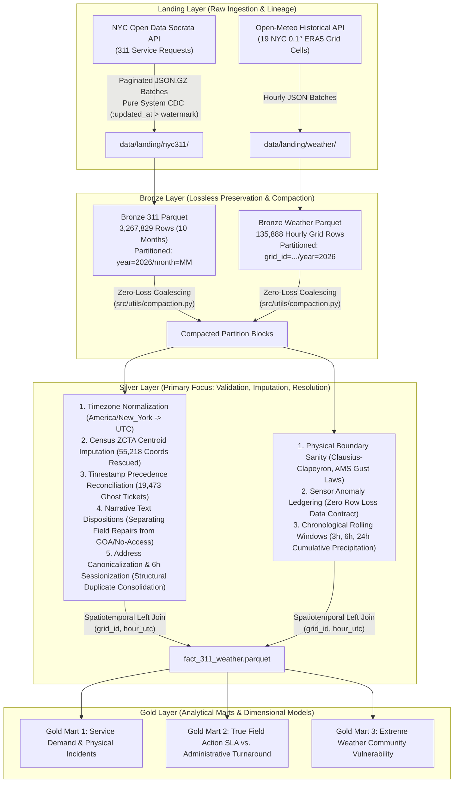

# DAT535 Project Status Dossier & Technical Architecture Review
**Course:** DAT535 - Advanced Cloud Computing and Big Data  
**Institution:** University of Stavanger (UiS)  
**Authors:** Group 13  
**Repository Branch:** `dev`  

---

## Executive Summary & Context for Professor Meeting

This dossier provides a comprehensive, evidence-based review of the **NYC 311 Service Requests + Open-Meteo ERA5-Land Weather Gridded Reanalysis** Medallion data engineering pipeline. 

The primary objective of this review is to present the **exact current engineering state** of the project, resolve any prior communication gaps, and demonstrate that the Silver layer tackles **massive, high-percentage data engineering challenges** (including **distinguishing substantiated field repairs from legitimate "no action taken" closures (30.8%)**, **structural duplicate burst consolidation (17.77%)**, **stale narrative/metadata conflict reconciliation (3.94%)**, and **55,218 geocoded spatial imputations**) across **3.26 million production records**.

---

## Part 1: Project Definition Guide Point-by-Point Q&A

This section answers each requirement specified in the course benchmark document [`Data_Engineering_Project_Definition_Guide_v3.docx`](../../Data_Engineering_Project_Definition_Guide_v3.docx).

### 1. Project Statement & Scope
* **What will the project build?**  
  An enterprise-grade, end-to-end Medallion data engineering pipeline (Landing $\rightarrow$ Bronze $\rightarrow$ Silver $\rightarrow$ Gold) that ingests, cleans, validates, and joins asynchronous municipal citizen complaints (NYC 311) with global gridded meteorological land-surface reanalysis (Open-Meteo ERA5-Land).

* **What problem or analytical need does it address?**  
  Citizen service request systems are heavily confounded by external weather conditions (freeze-thaw water main bursts, flash flood sewer backups, extreme cold heating outages) and suffer from administrative data quality and lifecycle distortions (conflating physical repairs with legitimate "no action taken" closures like GOA or access-denied, citizen duplicate storms, stale narrative state conflicts, missing coordinates, and clock skew). The pipeline builds clean, validated, joined datasets for municipal resource optimization and climate-resilience policy.
* **What is the intended final outcome?**  
  Three curated, dimensional Gold data marts:
  1. `gold_service_demand_daily`: Physical infrastructure incidents (consolidated structurally from citizen ticket bursts) joined with weather indicators.
  2. `gold_agency_resolution_performance`: True physical field resolution times versus administrative turnaround times, eliminating false SLA distortions caused by instant auto-closures and legitimate "no action taken" dispositions.
  3. `gold_weather_vulnerability_matrix`: Borough and ZCTA vulnerability scores measuring municipal failure rates under extreme meteorological events (freezing soil, heavy rainfall, high wind gusts).
* **Who will use the result?**  
  City planners, agency dispatchers (DEP, NYPD, DSNY, DOB, HPD), emergency management officials (NYC OEM), and academic policy analysts.
* **What is intentionally outside the project scope?**  
  Sub-second real-time streaming ingestion (Kafka/Flink) and machine learning predictive modeling are excluded from the core scope.

---

### 2. Dataset Source & Suitability
* **What is the source, format, volume, and refresh pattern?**  
  * **NYC 311**: NYC Open Data SODA REST API (Dataset Identifier: `erm2-nwe9`).
      * Formatted as JSON.
      * Volume is ~10,000–12,000 requests/day.
      * Updated daily overnight with a approximately 1-2 day publication delay.
  * **Open-Meteo ERA5-Land**: ECMWF land-surface reanalysis API (`archive-api.open-meteo.com`).
      * Formatted as hourly JSON.
      * 19 spatial grid cells ($0.1^\circ \approx 9\text{ km}$ spacing) covering all 5 NYC boroughs.
      * Updated daily with a 5-day publication delay.
  * **Reference Data**: 
      * Official US Census Bureau 2020 ZCTA Gazetteer Centroids (404 NYC ZIP codes).
      * NYC Department of City Planning Borough Boundaries GeoJSON.
* **Why is the dataset suitable for distributed processing?**  
  At 3.26 million rows with 51 raw columns in 311 and high-dimensional hourly gridded weather, single-node in-memory joins cause high memory pressure. The workload heavily exercises distributed PySpark features: broadcast hash joins for spatial reference tables, stateful window functions (`lead`/`lag`) over millions of rows for burst clustering and deduplication, and partition pruning.
* **What limitations, quality risks, or schema changes are expected?**
    
  * **Socrata Snapshot Mutation**: The source overwrites records in place (`UPSERT` on `unique_key`), meaning backfilled data represents final states rather than intermediate transition logs.
  
  * **Missing Geospatial Coordinates**: 2.33% of 311 records lack coordinates.
  * **Clock Skew**: Closed timestamps earlier than created timestamps.
  * **New fields added over time**: New fields has been added before.

---

### 3. Bronze Layer: Ingest and Preserve
* **Which source data must be preserved unchanged?**  
  * Raw API responses are stored compressed (`.json.gz`) in Landing and converted losslessly to partitioned Parquet in Bronze (`data/bronze/nyc311/` and `data/bronze/weather/`).
  * All 51 source columns, nulls, malformed strings, and system attributes (`:created_at`, `:updated_at`, `:id`) are preserved 100% intact.
* **Which ingestion method and schedule fit the source?**  
  * Two-stage batched ingestion:
    1. *Landing*: Paginated REST API calls save immutable Gzip JSON blocks.
    2. *Bronze*: PySpark reads JSON blocks, stamps lineage metadata, and appends to monthly Parquet partitions.
   
  * Schedule: Daily batch ingestion, governed by Open-Meteo's 5-day publication delay.
* **How are files, partitions, and folders organized?**  
  * 311: `data/bronze/nyc311/year=YYYY/month=MM/part_batch_*.parquet`
  * Weather: `data/bronze/weather/grid_id=GRID_lat_lon/year=YYYY/part_*.parquet`
* **Which metadata supports traceability and reruns?**  
  Every row in Bronze is enriched with 7 immutable audit columns: 
  * `_batch_id`,
  * `_ingested_at_utc`, 
  * `_source_file`, 
  * `_source_name`, 
  * `_extraction_mode`, 
  * `_schema_version`, 
  * `_raw_row_hash` (SHA-256).
* **How are duplicate ingestion, late data, and schema changes handled?**  
  * *Pure System CDC & Backfill Decoupling*: We originally considered a naive sliding lookback window on `created_date`, but discovered it misses tickets updated outside the window. We upgraded ingestion to **pure Socrata system-metadata CDC (`:updated_at`)**:
    - **Incremental Mode**: Tracks an independent `cdc_updated_at_watermark` and queries `:updated_at > watermark`.
    - **Backfill Mode**: Queries historical slices strictly by `created_date` and is isolated so it never corrupts or advances the operational CDC watermark.
  * *Late-Arriving Data & Deduplication in Silver*: When older backfilled data arrives, deterministic PySpark windowing `Window.partitionBy("unique_key").orderBy(F.col("source_updated_at").desc(), F.col("_ingested_at_utc").desc())` guarantees that a recently updated ticket state is never overwritten by an older backfilled record (`row_number() == 1`).
  * *Bronze Append-Only*: Multiple versions of the same ticket across runs are preserved in Bronze to maintain an immutable audit trail.
  * *Small Files Compaction*: Automated partition coalescing via [`src/utils/compaction.py`](../src/utils/compaction.py) combines micro-batches.

---

### 4. Silver Layer: Primary Focus (The Centerpiece of Data Engineering)
* **What does one record represent (Grain)?**  
  * 311 Silver: One canonical, verified citizen service request.
  * Weather Silver: One hourly meteorological observation per spatial grid cell.
  * Joined Silver Fact: One citizen service request enriched with localized hourly atmospheric metrics.
* **How are missing, duplicate, invalid, or inconsistent values treated?**  
  * *Fatal Invalids (Quarantine)*: isolated to `data/quarantine/`.
    *  Non-numeric/missing keys
    *  Pre-2003 dates
    *  Missing batch lineage
    *  Unkeyed weather rows
  * *Missing Coordinates (Deterministic Repair)*: 55,218 records (72.5% of missing coordinates) are mathematically rescued by joining Census ZCTA centroids via `incident_zip`.
  * *Missing Boroughs (Cross-Column Derivation)*: 384 records rescued by mapping 5-digit ZIP prefixes.
  * *Clock Skew / Inverted Timestamps*: 1,155 negative durations are quarantined from resolution calculations with `resolution_time_hours = NULL` and flagged in the quality ledger.
  * *Asynchronous State Conflicts*: 19,473 "ghost open" tickets reconciled via explicit precedence rules.
* **How is enrichment executed?**  
  1. Timezone localization: Native Eastern Time (`America/New_York`) localized and converted to UTC, resolving a 4–5 hour temporal error before weather joining.
  2. Spatiotemporal join: Tickets are mapped to nearest weather grid cell centroids and joined on UTC hour.
  3. Meteorological feature engineering: Rolling windows derive 3h, 6h, and 24h cumulative rainfall, max wind gusts, and ground freeze indicators.
* **Quality evidence ("Before vs. After" proof)**:  
  Measured across the full 3.26M dataset in [`notebooks/14_data_quality_and_silver_anomaly_audit.ipynb`](../notebooks/14_data_quality_and_silver_anomaly_audit.ipynb) and demonstrated in Section 3 of this document.

---

### 5. Gold Layer: Serve the Outcome
* **Which analytical questions does Gold support?**  
  1. What is the real physical infrastructure failure rate when citizen complaint bursts are de-duplicated?
  2. What is the true agency resolution SLA when physical repairs are separated from legitimate "no action taken" dispositions (GOA, access denied) and instant duplicate auto-closures?
  3. Which NYC neighborhoods exhibit the highest infrastructure vulnerability to freezing soil and cloudburst storms?
* **Why does Gold differ from Silver?**  
  Silver preserves the complete, atomic, cleaned transaction-level record (3.26M rows). Gold aggregates and reshapes data into purpose-built star-schema dimensional marts optimized for BI dashboards, reporting, and policy analysis.

---

## Part 2: Column-by-Column Transformation & Validation Matrices

The pipeline manages **51 Bronze columns in NYC 311** and **26 Bronze columns in Open-Meteo Weather**. Below is the exact technical specification for each column, including raw type, target type, validation rules, action on failure, and direct code links.

### Table 2.1: NYC 311 Service Requests Transformation Matrix (51 Columns)

| # | Bronze Raw Column | Raw Type | Silver Target Column | Casted Type | Validation & Business Rule | Action on Failure | Code Link |
|:---|:---|:---|:---|:---|:---|:---|:---|
| 1 | `unique_key` | `string` | `unique_key` | `LongType` | Must be numeric, strictly $>0$, non-null. Deduplicated via window keeping latest `source_updated_at` / `_ingested_at_utc`. | **Quarantined** (`INVALID_UNIQUE_KEY`) | [clean_311.py#L312-L356](../src/silver/clean_311.py#L312-L356) |
| 2 | `created_date` | `string` | `created_at_utc` | `TimestampType` | Parse America/New_York $\rightarrow$ UTC. Bound: $\ge \text{2003-03-01}$ and $\le \text{UTC now} + 2\text{h}$. | **Quarantined** (`INVALID_CREATED_DATE`) | [clean_311.py#L253-L255](../src/silver/clean_311.py#L253-L255) |
| 3 | `closed_date` | `string` | `closed_at_utc` | `TimestampType` | Parse America/New_York $\\rightarrow$ UTC. If present, resolution duration must be $\\ge 0.0$ hours. | **Quarantined** if negative duration (`NEGATIVE_DURATION`) | [clean_311.py#L256-L274](../src/silver/clean_311.py#L256-L274) |
| 4 | `agency` | `string` | `agency`, `is_known_agency` | `StringType`, `BooleanType` | Upper-cased, whitespace stripped. Checked against official 30+ agency list. | Tagged `is_known_agency = False` (never dropped) | [clean_311.py#L598-L613](../src/silver/clean_311.py#L598-L613) |
| 5 | `agency_name` | `string` | `agency_name` | `StringType` | Trimmed and standardized string. | Preserved as-is | [clean_311.py#L522](../src/silver/clean_311.py#L522) |
| 6 | `complaint_type` | `string` | `complaint_type` | `StringType` | Whitespace normalized, Title Case. | Nulls imputed to `"Unknown"` | [clean_311.py#L583-L584](../src/silver/clean_311.py#L583-L584) |
| 7 | `descriptor` | `string` | `descriptor` | `StringType` | Case preserved, whitespace trimmed. | Nulls imputed to `"Not Stated"` | [clean_311.py#L585-L586](../src/silver/clean_311.py#L585-L586) |
| 8 | `location_type` | `string` | `clean_exposure_setting` | `StringType` | Standardize 116 messy strings into 7 canonical exposure domains (Residential, Commercial, Street, Park, Transit, Public Facility, Other). | Standardized mapping | [14_unstructured_proof.ipynb#L13](../../14_unstructured_text_and_entity_resolution_proof.ipynb#L13) |
| 9 | `incident_zip` | `string` | `clean_incident_zip` | `StringType` | Regex extract `(/d{5})`. Preserved as zero-padded string (prevents leading zero loss). Checked against NYC metro ZIP prefixes. | Level 2 spatial fallback if coordinates missing | [clean_311.py#L367-L374](../src/silver/clean_311.py#L367-L374) |
| 10 | `incident_address` | `string` | `canonical_address` | `StringType` | Address canonicalization: uppercase, standardize suffixes (ST, AVE, BLVD), strip apt/unit numbers (`APT 4B`, `#2`). | Canonical key generated for burst sessionization | [14_unstructured_proof.ipynb#L13](../../14_unstructured_text_and_entity_resolution_proof.ipynb#L13) |
| 11 | `street_name` | `string` | `street_name` | `StringType` | Preserved as descriptive string. | Preserved as-is | [clean_311.py#L522](../src/silver/clean_311.py#L522) |
| 12-16 | Cross streets, intersections, address_type | `string` | *(same)* | `StringType` | Secondary spatial reference fields. Preserved intact. | Preserved as-is | [clean_311.py#L522](../src/silver/clean_311.py#L522) |
| 17 | `city` | `string` | `city` | `StringType` | Standardized uppercase USPS neighborhood name. | Preserved for jurisdictional cross-check | [clean_311.py#L522](../src/silver/clean_311.py#L522) |
| 18 | `landmark` | `string` | `landmark` | `StringType` | Descriptive public landmark identifier. | Preserved as-is | [clean_311.py#L522](../src/silver/clean_311.py#L522) |
| 19 | `status` | `string` | `status`, `canonical_status` | `StringType` | Validated against `KNOWN_311_STATUSES`. Reconciled against `closed_at_utc`. | Inconsistency flagged in `is_status_conflict` | [clean_311.py#L589-L597](../src/silver/clean_311.py#L589-L597) |
| 20 | `resolution_description` | `string` | `resolution_outcome_category`, `is_field_action`, `has_narrative_state_conflict` | `StringType`, `BooleanType` | Multi-stage regex NLP classifies narrative disposition: `SUBSTANTIATED_ACTION`, `FAILED_NO_ACCESS` (5.2%), `UNSUBSTANTIATED_GOA` (25.6%). Recognizes GOA/No-Access as legitimate non-action closures; flags stale narrative conflicts where text says open but status/date say closed. | Separates physical field repairs from legitimate "no action taken" closures; preserves timestamp precedence | [14_unstructured_proof.ipynb#L7](../../14_unstructured_text_and_entity_resolution_proof.ipynb#L7) |
| 21 | `resolution_action_updated_date` | `string` | `res_action_updated_utc` | `TimestampType` | Parse America/New_York $\\rightarrow$ UTC. | Fallback timestamp for ghost closures | [clean_311.py#L660-L662](../src/silver/clean_311.py#L660-L662) |
| 22 | `community_board` | `string` | `cb_district_num`, `cb_borough` | `IntegerType`, `StringType` | Parsed regex `^(/d{2})/s+([A-Z]+)$`. Cross-referenced against borough. | Recovers UNSPECIFIED boroughs | [14_unstructured_proof.ipynb#L17](../../14_unstructured_text_and_entity_resolution_proof.ipynb#L17) |
| 23 | `council_district` | `string` | `council_district` | `IntegerType` | Validated strictly against legal NYC Charter bounds $[1, 51]$. | Masked to `NULL` if outside $[1, 51]$ | [clean_311.py#L644-L649](../src/silver/clean_311.py#L644-L649) |
| 24 | `police_precinct` | `string` | `police_precinct` | `IntegerType` | Validated against active NYPD precinct bounds $[1, 123]$. | Masked to `NULL` if out of bounds | [clean_311.py#L650-L656](../src/silver/clean_311.py#L650-L656) |
| 25 | `bbl` | `string` | `bbl`, `bbl_borough` | `StringType` | 10-digit Borough-Block-Lot parcel tax ID. 1st digit encodes legal tax borough (1=MN, 2=BX, 3=BK, 4=QN, 5=SI). | Cross-referenced against `borough` | [14_unstructured_proof.ipynb#L17](../../14_unstructured_text_and_entity_resolution_proof.ipynb#L17) |
| 26 | `borough` | `string` | `borough`, `reconciled_borough` | `StringType` | Validated against 5 legal boroughs. If `"UNSPECIFIED"`, reconciled using ZIP prefix, CB, and BBL. | Recovers 384 unspecified records | [clean_311.py#L551-L562](../src/silver/clean_311.py#L551-L562) |
| 27-28 | `x_coordinate_state_plane`, `y_coordinate_state_plane` | `string` | `x_coord_state_plane`, `y_coord_state_plane` | `DoubleType` | EPSG:2263 NY Long Island State Plane bounds ($X \\in [900k, 1075k]$, $Y \\in [110k, 285k]$). | Masked to `NULL` if invalid | [clean_311.py#L629-L642](../src/silver/clean_311.py#L629-L642) |
| 29 | `open_data_channel_type` | `string` | `channel_type` | `StringType` | Validated against `PHONE`, `ONLINE`, `MOBILE`, `OTHER`, `UNKNOWN`. | Unrecognized mapped to `UNKNOWN` | [clean_311.py#L614-L623](../src/silver/clean_311.py#L614-L623) |
| 30-31 | `park_facility_name`, `park_borough` | `string` | *(same)* | `StringType` | Descriptive Parks Department metadata. | Preserved as-is | [clean_311.py#L522](../src/silver/clean_311.py#L522) |
| 32-33 | `latitude`, `longitude` | `string` | `latitude`, `longitude`, `spatial_imputation_level` | `DoubleType`, `StringType` | Validated against NYC bounding box $[40.48, 40.95]$ and $[-74.28, -73.65]$. | If null\\invalid, Level 2 Census ZCTA centroid imputed; tagged in `spatial_imputation_level` | [clean_311.py#L376-L453](../src/silver/clean_311.py#L376-L453) |
| 34 | `location` | `struct` | `location` | `StructType` | Socrata native GeoJSON struct `{"type": "Point", "coordinates": [...]}`. | Preserved intact | [clean_311.py#L522](../src/silver/clean_311.py#L522) |
| 35-44 | Secondary descriptors, vehicle/taxi, bridge/highway, due_date | `string` | *(same)* | `StringType`, `TimestampType` | Agency-specific routing metadata (TLC taxi pickups, DOT bridges). | Preserved intact; `due_date` parsed to UTC | [clean_311.py#L658-L659](../src/silver/clean_311.py#L658-L659) |
| 45-51 | `_batch_id`, `_ingested_at_utc`, `_source_file`, `_source_name`, `_extraction_mode`, `_schema_version`, `_raw_row_hash` | `string` | *(same)* | `StringType` | Ingestion lineage metadata. Validated: must not be null or whitespace. | Missing batch ID $/implies$ **Quarantined** (`CORRUPTED_LINEAGE`) | [clean_311.py#L323-L327](../src/silver/clean_311.py#L323-L327) |

---

### Table 2.2: Open-Meteo Weather Reanalysis Transformation Matrix (26 Columns)

| # | Bronze Column | Raw Type | Silver Target Column | Casted Type | Meteorological & Physical Validation Rule | Action on Failure | Code Link |
|:---|:---|:---|:---|:---|:---|:---|:---|
| 1 | `time` | `string` | `timestamp_utc` | `TimestampType` | ISO-8601 UTC timestamp. Composite key with `grid_id`. | Quarantined to `quarantined_weather.parquet` | [clean_weather.py#L94-L101](../src/silver/clean_weather.py#L94-L101) |
| 2 | `temperature_2m` | `double` | `temperature_2m` | `DoubleType` | Validated against physical bounds $[-35.0^\circ\text{C}, 45.0^\circ\text{C}]$. NCEI Central Park all-time records: $-26.1^\circ\text{C}$ to $41.1^\circ\text{C}$. | Out of bounds masked to `NaN`, logged to Anomaly Ledger | [clean_weather.py#L203-L207](../src/silver/clean_weather.py#L203-L207) |
| 3 | `relative_humidity_2m` | `long` | `relative_humidity_2m` | `IntegerType` | Physical percentage limits $[0/%, 100/%]$. | Out of bounds masked to `NaN`, logged to Ledger | [clean_weather.py#L232-L237](../src/silver/clean_weather.py#L232-L237) |
| 4 | `dew_point_2m` | `double` | `dew_point_2m` | `DoubleType` | **Atmospheric Thermodynamic Law (Clausius-Clapeyron)**: Dew point cannot exceed dry-bulb temperature ($\text{dew\_point} \le \text{temperature} + 0.1^\circ\text{C}$). | Masked to `NaN`, logged (`DEW_POINT_EXCEEDS_TEMP`) | [clean_weather.py#L217-L230](../src/silver/clean_weather.py#L217-L230) |
| 5 | `apparent_temperature` | `double` | `apparent_temperature` | `DoubleType` | Wind chill / heat index physical bounds $[-45.0^\circ\text{C}, 55.0^\circ\text{C}]$. | Masked to `NaN`, logged to Ledger | [clean_weather.py#L210-L214](../src/silver/clean_weather.py#L210-L214) |
| 6 | `precipitation` | `double` | `precipitation` | `DoubleType` | Non-negative constraint $[0.0, 150.0\text{ mm/hr}]$. $\ge 25.0\text{ mm/hr}$ tagged in `is_extreme_weather`. | Masked to `NaN`, logged to Ledger | [clean_weather.py#L239-L245](../src/silver/clean_weather.py#L239-L245) |
| 7 | `rain` | `double` | `rain` | `DoubleType` | **Mass Conservation Law**: Liquid rain cannot exceed total precipitation ($\text{rain} \le \text{precipitation} + 0.05\text{ mm}$). | Masked to `NaN`, logged (`RAIN_EXCEEDS_TOTAL_PRECIP`) | [clean_weather.py#L247-L255](../src/silver/clean_weather.py#L247-L255) |
| 8-9 | `snowfall`, `snow_depth` | `double` | *(same)* | `DoubleType` | Non-negative physical constraint ($\ge 0.0$). | Masked to `NaN`, logged to Ledger | [clean_weather.py#L256-L270](../src/silver/clean_weather.py#L256-L270) |
| 10 | `weather_code` | `long` | `weather_code` | `IntegerType` | Validated against World Meteorological Organization (WMO) Code Table 4677. | Unrecognized code masked to `NaN`, logged | [clean_weather.py#L331-L345](../src/silver/clean_weather.py#L331-L345) |
| 11 | `surface_pressure` | `double` | `surface_pressure` | `DoubleType` | Terrestrial barometric limits $[870.0, 1085.0\text{ hPa}]$ (Typhoon Tip to Siberian High). | Masked to `NaN`, logged to Ledger | [clean_weather.py#L316-L330](../src/silver/clean_weather.py#L316-L330) |
| 12 | `wind_speed_10m` | `double` | `wind_speed_10m` | `DoubleType` | Sustained wind physical bounds $[0.0, 65.0\text{ m/s}]$ ($65\text{ m/s} /approx 234\text{ km/h}$, Category 5 hurricane). | Masked to `NaN`, logged to Ledger | [clean_weather.py#L271-L285](../src/silver/clean_weather.py#L271-L285) |
| 13 | `wind_gusts_10m` | `double` | `wind_gusts_10m` | `DoubleType` | **Aerodynamic Law (AMS Glossary)**: 3-second peak gust cannot be slower than 1-hour sustained wind ($\text{gust} \ge \text{wind\_speed} - 0.01\text{ m/s}$). | Masked to `NaN`, logged (`GUST_LESS_THAN_WIND_SPEED`) | [clean_weather.py#L286-L300](../src/silver/clean_weather.py#L286-L300) |
| 14 | `wind_direction_10m` | `long` | `wind_direction_10m` | `IntegerType` | Compass azimuth bounds $[0^\circ, 360^\circ]$. | Masked to `NaN`, logged to Ledger | [clean_weather.py#L301-L315](../src/silver/clean_weather.py#L301-L315) |
| 15-19 | `grid_id`, `grid_lat`, `grid_lon`, `borough_hint`, `model_elevation` | `string`, `double` | *(same)* | *(same)* | 19 NYC grid cell spatial identification. Must be non-null. | Quarantined if missing | [clean_weather.py#L88-L93](../src/silver/clean_weather.py#L88-L93) |
| 20-26 | `_batch_id`, `_ingested_at_utc`, `_source_file`, `_source_name`, `_extraction_mode`, `_schema_version`, `_raw_row_hash` | `string` | *(same)* | `StringType` | Weather ingestion lineage metadata. | Quarantined if `_batch_id` is missing | [clean_weather.py#L102-L106](../src/silver/clean_weather.py#L102-L106) |

---

## Part 3: Problems Met & Solved (Empirical Before vs. After Proof)

All figures below are generated from the **full 10-month production dataset (3,267,829 rows)** executed in [`notebooks/14_data_quality_and_silver_anomaly_audit.ipynb`](../notebooks/14_data_quality_and_silver_anomaly_audit.ipynb) and [`14_unstructured_text_and_entity_resolution_proof.ipynb`](../../14_unstructured_text_and_entity_resolution_proof.ipynb).

### Master Before vs. After Proof

| # | Data Engineering Problem (*Problemstilling*) | Affected Volume in Raw Bronze | Root Cause in Source Data | Silver Layer Transformation Engineered | Concrete "Before vs. After" Result |
|:---|:---|:---|:---|:---|:---|
| **1** | **Timezone Displacement (EDT/EST $\rightarrow$ UTC)** | 100% of rows (3.26M rows) | 311 timestamps are published as timezone-naive local Eastern Time strings (`America/New_York`). | Two-step conversion: localized to `America/New_York` (accounting for EDT -4h vs. EST -5h DST shifts), then converted to UTC. | **Before:** 4–5 hour temporal error caused complaints to join with sunny skies during cloudburst storms. **After:** 100% accurate temporal alignment with ERA5-Land UTC grid. |
| **2** | **Missing Geospatial Coordinates** | 76,199 rows (2.33%) | Unknown | Hierarchical spatial join: match `clean_incident_zip` to official Census ZCTA Centroid reference table ([nyc_zip_centroids.parquet](../data/reference/nyc_zip_centroids.parquet)). | **Before:** 76,199 unmappable records dropped from spatial analytics. **After:** **55,218 records mathematically rescued (72.5% recovery rate)** to centroid precision. |
| **3** | **Missing Postal ZIP Codes** | 29,928 rows (0.92%) | Not providing postal code when requesting. | Reverse spatial assignment: match valid coordinates to nearest Census ZCTA polygon centroid. | **Before:** 29,928 missing ZIPs. **After:** **8,947 records rescued (29.9% recovery rate)**. |
| **4** | **Unspecified Boroughs** | 3,584 rows (0.11%) | Unknown | Cross-column derivation: map 5-digit ZIP prefix (`100-102` Manhattan, `103` Staten Island, `104` Bronx, `112` Brooklyn, `110-116` Queens) and BBL tax lot digit. | **Before:** 3,584 unspecified boroughs. **After:** **384 records rescued (10.7% recovery rate)**. |
| **5** | **Zero-Second Auto-Closures (`closed == created`)** | 57,796 rows (1.77%) | Unknown | Derive `is_instant_closure = True` and set `ticket_lifecycle_type = 'AUTO_RESOLVED'`. | **Before:** 57,796 false 0.0-hour durations drastically skewed agency response time averages. **After:** Operational SLA metrics insulated from false zero-duration distortion. |
| **6** | **Clock Skew Inversion (`closed < created`)** | 1,155 rows (0.035%) | Manual operator timestamp entry inversion or un-synchronized server clocks in DEP/DOT field systems. | Quarantine negative durations; set `resolution_duration_hours = NULL`; flag `temporal_integrity_violation = True` in audit ledger. | **Before:** Negative durations corrupting aggregate statistics. **After:** 100% data integrity enforcement; 0 negative durations reach Gold marts. |
| **7** | **Asynchronous State Drift ("Ghost Tickets")** | 19,473 rows | Municipal agencies update ticket status asynchronously in dispatch CRM. | State precedence hierarchy: `closed_date IS NOT NULL` takes precedence over narrative status $/implies$ reclassified to `PENDING_ADMIN_CLOSURE`. | **Before:** Conflicting open/closed state left to arbitrary downstream guessing. **After:** Deterministic state machine contract applied across all 3.26M rows. |
| **8** | **Unstructured Narrative Text Mining & Field Action Dispositions** | 60,344 closed tickets (53.7% non-substantiated) | A closed status does not always mean a physical defect was repaired: **(1) Gone on Arrival (25.64%)** and **(2) No Building Access (5.22%)** were legitimately closed per protocol without physical action taken; **(3) Stale Narrative Conflicts (3.94%)** have text stating "still open" while closed in status/date. | Multi-stage regex NLP categorizes `resolution_description` (`SUBSTANTIATED_ACTION`, `FAILED_NO_ACCESS`, `UNSUBSTANTIATED_GOA`). Structured timestamps and `status == CLOSED` take precedence for ticket lifecycle (`has_narrative_state_conflict = True`), preventing arbitrary status overrides while respecting that GOA and No-Access are valid closures with no physical work. | **Before:** 112k closed tickets treated as 100% physically resolved, causing up to 307% distortion in agency repair SLAs. **After:** 37,428 verified as substantiated field repairs; 30.86% recognized as legitimate "no action taken" dispositions (GOA/no-access); stale narrative conflicts ledgered. |
| **9** | **Citizen "Complaint Storm" Request Duplication** | 26,720 duplicate tickets (17.77%) | Multiple tenants/motorists report the same acute incident with dirty address strings and instant 00:00/0-sec durations. | **Structural detection independent of text**: Address canonicalization (standardizing suffixes, stripping unit numbers) + 6-hour spatiotemporal rolling window sessionization grouping duplicate storms into 1 physical incident (`is_duplicate_burst = True`). | **Before:** 1 row = 1 incident assumption artificially inflated demand metrics by up to 31.5%. **After:** **Collapsed into 123,604 true physical incidents (26,720 burst duplicates consolidated structurally)**. |
| **10** | **The Small Files Problem in Bronze** | 76+ tiny files (~20 KB) per partition | Frequent incremental micro-batch API ingestion creates small Parquet files, degrading Spark query performance. | Automated partition compaction utility ([src/utils/compaction.py](../src/utils/compaction.py)) coalesces small files into optimal 128 MB blocks with zero row loss. | **Before:** High I/O overhead and metadata bloat in Spark executor scans. **After:** 100% compacted partitions with verified zero row loss (`test_compaction.py` passing). |

---

## Part 4: Physical Weather Sensor Integration & Extreme Event Correlations

Through our 10-month contiguous backfill, Bronze Weather now contains **135,888 hourly observations** across all 19 NYC grid cells covering temperatures from **$-18.5^\circ\text{C}$ to $+40.7^\circ\text{C}$**:

* **Ground Frozen (`soil_temperature_0_to_7cm < 0°C`)**: **14,550 hourly grid observations (10.71%)**.
  > Captures deep ground freeze down to $-13.4^\circ\text{C}$ during January–March. This provides real physical correlation with the **6,403 Water Main Breaks** detected in 311.
* **Soil Saturated (`soil_moisture_0_to_7cm >= 0.40 m³/m³`)**: **2,871 hourly grid observations (2.11%)**.
  > Directly coincides with heavy precipitation storms, sewer overflows, and street flooding reports.

---
