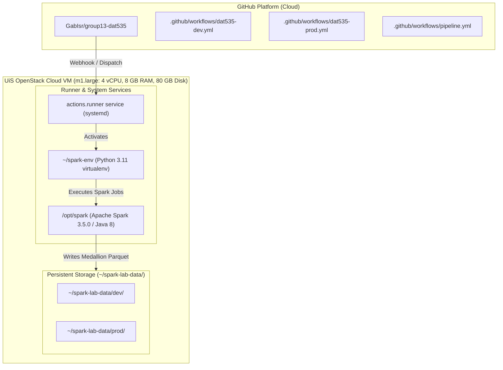
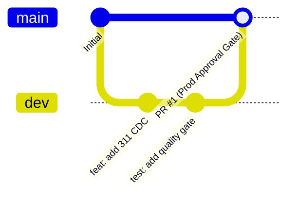

# Self-Hosted Runner & OpenStack VM Infrastructure Setup Guide

This guide provides the complete, end-to-end technical procedure for provisioning the Linux cloud virtual machine on the University of Stavanger (UiS) OpenStack cluster, configuring the Apache Spark execution runtime, registering the GitHub Actions self-hosted runner daemon, and establishing the Dev/Prod automated CI/CD environments.

---

## Table of Contents
1. [Architecture Overview](#1-architecture-overview)
2. [Prerequisites & VS Code Extensions](#2-prerequisites--vs-code-extensions)
3. [OpenStack VM Provisioning](#3-openstack-vm-provisioning)
4. [Runtime & Apache Spark Installation](#4-runtime--apache-spark-installation)
5. [Persistent Lakehouse Storage Configuration](#5-persistent-lakehouse-storage-configuration)
6. [GitHub Actions Self-Hosted Runner Registration](#6-github-actions-self-hosted-runner-registration)
7. [GitHub Environments & CI/CD Deployment Gates](#7-github-environments--cicd-deployment-gates)
8. [Repository Setup & Branching Strategy](#8-repository-setup--branching-strategy)
9. [Operational Verification & Troubleshooting](#9-operational-verification--troubleshooting)
10. [Consolidated Setup Checklist](#10-consolidated-setup-checklist)

---

## 1. Architecture Overview

To provide scalable compute for distributed PySpark transformations and avoid the compute/storage limits of hosted runners, automated testing and pipeline orchestration run on a dedicated self-hosted Linux runner provisioned on the UiS OpenStack private cloud.



---

## 2. Prerequisites & VS Code Extensions

### Campus Network Access
* The UiS OpenStack Horizon dashboard and VM SSH endpoints are hosted within the university's private IP space (`152.94.0.0/16`).
* When working off-campus, you **must connect to the UiS VPN** (via Educloud / Cisco Secure Client) before accessing the Horizon dashboard or SSH endpoints.
* Login credentials for the Horizon dashboard are provided during the course lab orientation.

### Required VS Code Extensions
Install the following extensions from the Visual Studio Code Extensions marketplace (`Ctrl+Shift+X` or `Cmd+Shift+X`):

| Extension | Marketplace ID | Purpose |
| :--- | :--- | :--- |
| **Remote - SSH** | `ms-vscode-remote.remote-ssh` | Direct filesystem access and remote terminal on the VM |
| **Python** | `ms-python.python` | Python language support, debugging, and interpreter selection |
| **Jupyter** | `ms-toolsai.jupyter` | Native notebook execution and remote kernel debugging |
| **GitLens** | `eamodio.gitlens` | Git commit visualization and branch comparison |
| **GitHub Actions** | `github.vscode-github-actions` | Monitor workflow runs and view step logs directly inside VS Code |

---

## 3. OpenStack VM Provisioning

### Step 1: Log in to OpenStack Horizon
1. Open your web browser and navigate to the UiS OpenStack Horizon dashboard:  
   **[http://5gnuc1.ux.uis.no/horizon](http://5gnuc1.ux.uis.no/horizon)**
2. Authenticate using your university-assigned OpenStack project credentials.

### Step 2: Configure Network Security Groups
Before launching an instance, ensure inbound SSH traffic is permitted:
1. Navigate to: **Project** → **Network** → **Security Groups**.
2. Select your security group (e.g., `default`) and click **Manage Rules**.
3. If an SSH rule does not already exist, click **Add Rule**:
   * **Rule**: Select `SSH`.
   * **Direction**: `Ingress`.
   * **Port**: `22`.
   * **Remote**: `CIDR`.
   * **CIDR**: `152.94.0.0/16` *(opens to the whole university network/VPN)*.
4. Click **Add**.

> [!NOTE]
> If you plan to access the standalone Spark Web UI (`8080`) or remote Jupyter notebooks (`8888`) directly in your browser, add custom TCP ingress rules for ports `8080` and `8888` using the same `152.94.0.0/16` CIDR.

### Step 3: Launch the VM Instance
1. Navigate to: **Project** → **Compute** → **Instances**.
2. Click **Launch Instance** and configure the wizard:
   * **Details**: Enter an instance name (e.g., `group13-spark-runner`).
   * **Source**:
     * *Boot Source*: `Image`.
     * *Create New Volume*: `No` (or `Yes`, allocating 40–80 GB).
     * *Select Image*: `Ubuntu 22.04 LTS` (or university-provided Ubuntu image).
   * **Flavor**: Select `m1.large` (4 VCPU, 8 GB RAM, 80 GB root disk).
   * **Networks**: Attach your project's private network.
   * **Security Groups**: Ensure your configured security group (with SSH rule) is active.
   * **Key Pair**: Select your existing SSH public key, or click **Create Key Pair** to generate and download a new private `.pem` key.
3. Click **Launch Instance**.

### Step 4: Allocate and Associate a Floating IP
1. In the **Instances** table, locate your newly created instance.
2. In the right-hand **Actions** dropdown, select **Associate Floating IP**.
3. If no floating IP is currently allocated to your project:
   * Click the **+** button next to *IP Address*.
   * Select the external pool and click **Allocate IP**.
4. Click **Associate**. Note the assigned public/campus Floating IP address (referred to below as `<FLOATING_IP>`).

### Step 5: Connect via SSH & VS Code Remote-SSH

#### Terminal Connection
From your local terminal (PowerShell, macOS Terminal, or Linux bash):
```bash
# Ensure correct read-only permissions on your private key (Unix/macOS)
chmod 400 ~/.ssh/dat535_key.pem

# SSH to the VM using the default ubuntu user
ssh -i ~/.ssh/dat535_key.pem ubuntu@<FLOATING_IP>
```

#### VS Code Remote-SSH Configuration
To connect VS Code directly to the cloud VM:
1. Press `Ctrl+Shift+P` (or `Cmd+Shift+P`) and select **Remote-SSH: Open SSH Configuration File...**.
2. Add the following host block:
   ```ssh-config
   Host uis-spark-vm
       HostName <FLOATING_IP>
       User ubuntu
       IdentityFile ~/.ssh/dat535_key.pem
   ```
3. Press `Ctrl+Shift+P` → **Remote-SSH: Connect to Host...** → select `uis-spark-vm`.
4. VS Code opens a new window connected directly to the VM filesystem.

---

## 4. Runtime & Apache Spark Installation

The automated setup script installs OpenJDK 8, builds a Python 3.11 virtual environment, deploys Apache Spark 3.5.0, configures environment variables, and creates service control scripts.

### Step 1: Transfer Installation Script to the VM
From your local machine within the project repository:
```bash
# Transfer the repository setup script to the VM home directory
scp -i ~/.ssh/dat535_key.pem scripts/setup_spark_env.sh ubuntu@<FLOATING_IP>:/home/ubuntu/
```

### Step 2: Execute the Installation Script
On the VM terminal:
```bash
# Make script executable
chmod +x ~/setup_spark_env.sh

# Run the installer (runtime: 15–45 minutes)
./setup_spark_env.sh
```

### Step 3: Technical Breakdown of Installation Steps
The `setup_spark_env.sh` script executes the following operations:
1. **System Packages**: Runs `sudo apt update && sudo apt upgrade -y`.
2. **Java 8 Runtime**: Installs `openjdk-8-jdk` and sets `JAVA_HOME=/usr/lib/jvm/java-8-openjdk-amd64` in `~/.bashrc`.
3. **Python 3.11 Setup**: Adds the `ppa:deadsnakes/ppa` repository, installs `python3.11`, `python3.11-venv`, `python3.11-dev`, and configures `update-alternatives` so `python3` defaults to version 3.11.
4. **Virtual Environment (`~/spark-env`)**: Creates a clean virtual environment at `~/spark-env`, upgrades `pip`, and installs core packages:
   ```bash
   pip install jupyter pyspark ipykernel findspark pandas matplotlib seaborn numpy pyarrow
   ```
   Registers the kernel for Jupyter: `python -m ipykernel install --user --name spark-env --display-name "Python (spark-env)"`.
5. **Apache Spark 3.5.0 Installation**: Downloads `spark-3.5.0-bin-hadoop3.tgz` from Apache archives, extracts it into `/opt/spark`, and assigns ownership to user `ubuntu`.
6. **Environment Variables**: Appends the following configuration to `~/.bashrc`:
   ```bash
   export JAVA_HOME=/usr/lib/jvm/java-8-openjdk-amd64
   export SPARK_HOME=/opt/spark
   export PATH=$PATH:$SPARK_HOME/bin:$SPARK_HOME/sbin
   export PYSPARK_DRIVER_PYTHON=jupyter
   export PYSPARK_DRIVER_PYTHON_OPTS='notebook'
   export PYSPARK_PYTHON=python3
   source ~/spark-env/bin/activate
   ```
7. **Jupyter Configuration**: Generates `~/.jupyter/jupyter_notebook_config.py` bound to `0.0.0.0:8888` without browser launch.
8. **Sample Spark Notebook**: Creates `~/spark-notebooks/spark_test.ipynb` with verification test cells.
9. **Helper Control Scripts**: Generates executable management scripts in `~/`:
   * `~/start-spark-notebook.sh`: Launches a background Jupyter Notebook daemon on port 8888.
   * `~/start-spark-standalone.sh`: Launches local Spark Master (port 8080) and Worker (port 7077).
   * `~/spark-status.sh`: Verifies whether Master, Worker, and Jupyter processes are active.
   * `~/stop-spark.sh`: Gracefully shuts down Master, Worker, and Jupyter processes.

### Step 4: Reload Bash Profile and Verify
```bash
source ~/.bashrc
source ~/spark-env/bin/activate

# Verify Java 8
java -version

# Verify PySpark 3.5.x
python3 -c "import pyspark; print('PySpark Version:', pyspark.__version__)"
```

---

## 5. Persistent Lakehouse Storage Configuration

By default, temporary directories such as `/tmp` are wiped upon VM reboot or cleared by Linux `systemd-tmpfiles`. To preserve Bronze raw archives, Silver conformances, quality anomaly ledgers, and Gold analytical marts across reboot cycles and workflow runs, persistent directory trees must be initialized:

```bash
# Create isolated persistent directories for Dev and Prod pipelines
mkdir -p $HOME/spark-lab-data/dev
mkdir -p $HOME/spark-lab-data/prod

# Verify write permissions
touch $HOME/spark-lab-data/dev/.keep $HOME/spark-lab-data/prod/.keep
```

In GitHub Actions workflows:
* The Dev workflow targets `$HOME/spark-lab-data/dev`.
* The Production deployment targets `$HOME/spark-lab-data/prod`.

---

## 6. GitHub Actions Self-Hosted Runner Registration

Registering the VM as a GitHub Actions self-hosted runner allows repository workflows to execute directly inside the VM's Python 3.11 and PySpark environment.

### Step 1: Generate Registration Token on GitHub
1. In your web browser, navigate to your GitHub repository:  
   `https://github.com/GabIsr/group13-dat535`
2. Go to: **Settings** → **Actions** → **Runners**.
3. Click **New self-hosted runner**.
4. Select **Runner image**: `Linux`, **Architecture**: `x64`.
5. Keep the browser page open to copy the generated `./config.sh` token command.

### Step 2: Download and Configure the Runner on the VM
SSH into your VM and run:
```bash
# Create dedicated directory for the runner
mkdir -p ~/actions-runner && cd ~/actions-runner

# Download the latest runner package (adjust version as indicated by GitHub)
curl -o actions-runner-linux-x64-2.321.0.tar.gz -L \
  https://github.com/actions/runner/releases/download/v2.321.0/actions-runner-linux-x64-2.321.0.tar.gz

# Extract the archive
tar xzf ./actions-runner-linux-x64-2.321.0.tar.gz

# Configure the runner against your repository
./config.sh --url https://github.com/GabIsr/group13-dat535 --token <GENERATED_TOKEN>
```

When prompted during `./config.sh`:
* **Runner name**: Press Enter (defaults to hostname) or specify `group13-runner-vm`.
* **Runner group**: Press Enter (default).
* **Labels**: Press Enter to accept defaults (`self-hosted`, `Linux`, `X64`).
* **Work folder**: Press Enter (defaults to `_work`).

### Step 3: Install and Start Runner as a System Daemon
To ensure the runner starts automatically on boot and recovers from crashes, install it as a `systemd` service:
```bash
cd ~/actions-runner

# Install systemd service
sudo ./svc.sh install

# Start the runner service
sudo ./svc.sh start

# Verify running status
sudo ./svc.sh status
```

On GitHub under **Settings** → **Actions** → **Runners**, your runner will now display a green **Idle** status badge.

---

## 7. GitHub Environments & CI/CD Deployment Gates

The CI/CD pipeline enforces an industry-standard Dev/Prod isolation pattern:

### 1. Create the `dev` Environment
1. Navigate to: **Settings** → **Environments** → **New environment**.
2. Name: `dev` → Click **Configure environment**.
3. Leave **Deployment protection rules** unchecked (allows automated execution on every PR/push to `dev`).
4. Under **Environment secrets**, add `SOCRATA_APP_TOKEN` if you want authenticated API ingestion in dev runs.

### 2. Create the `main` (Production) Environment
1. Click **New environment** → Name: `main`.
2. Under **Deployment protection rules**:
   * Enable **Required reviewers**.
   * Add group members / codeowners as designated approvers.
3. Save protection rules. Now, production pipeline deployments require an explicit manual sign-off before executing.
4. Under **Environment secrets**, add `SOCRATA_APP_TOKEN`.

---

## 8. Repository Setup & Branching Strategy

### Initial Repository Setup (VM / Local)
If cloning the repository fresh onto the VM:
```bash
# Clone the repository
git clone https://github.com/GabIsr/group13-dat535.git

# Move inside the directory
cd group13-dat535

# For forks: link original course upstream (if applicable)
# git remote add upstream https://github.com/jayachanders/dat535.git
```

### Development Lifecycle & Branch Strategy



1. **Local or Cluster Development (`dev` branch)**:
   ```bash
   # Create and switch to dev branch
   git checkout -b dev

   # Make changes and run local tests
   python run_project.py test

   # Commit and push
   git add .
   git commit -m "feat(silver): improve burst sessionization"
   git push -u origin dev
   ```

2. **Automated Dev Gate (`dat535-dev.yml`)**:
   * Triggers automatically on push/PR to `dev`.
   * Activates `~/spark-env/bin/activate`.
   * Asserts PySpark 3.5.x / Java 8 runtime alignment.
   * Executes the 83-test automated test suite (`python run_project.py test`).
   * Executes incremental pipeline into `$HOME/spark-lab-data/dev`.
   * Generates step summary quality scorecards and uploads artifacts.

3. **Production Release (`dat535-prod.yml`)**:
   * Open Pull Request on GitHub: `dev` → `main`.
   * Review diff, approve, and merge PR.
   * Production deployment triggers and pauses for designated reviewer sign-off.
   * Upon approval, executes pipeline into `$HOME/spark-lab-data/prod`.

4. **Scheduled Daily Operations (`pipeline.yml`)**:
   * Triggers automatically at **14:00 UTC** daily.
   * Ingests incremental CDC batches aligned with ECMWF ERA5-Land $D-5$ publication lag and updates data marts.

---

## 9. Operational Verification & Troubleshooting

### Triggering Workflows Manually
To test a workflow without pushing commits or waiting for the schedule:
1. Navigate to the repository's **Actions** tab on GitHub.
2. Select the target workflow (e.g., *DAT535 — Production Pipeline* or *Scheduled Incremental Pipeline*) from the left sidebar.
3. Click the **Run workflow** dropdown button on the right.
4. Select the branch and input parameters (e.g., `lab: all` or `mode: incremental`), then click **Run workflow**.

### Viewing Run Results & Logs
* **Web Browser**: Go to GitHub → **Actions** tab → select any run to view live, streaming step logs and download generated Parquet artifacts.
* **VS Code GitHub Actions Extension**: Click the GitHub Actions icon in the left Activity Bar to inspect workflow runs and view logs inline inside VS Code.

### Runner Service Management
If the runner stops responding or needs restarting:
```bash
cd ~/actions-runner

# Check daemon status
sudo ./svc.sh status

# Restart daemon
sudo ./svc.sh stop
sudo ./svc.sh start

# Inspect systemd logs
journalctl -u actions.runner.* -f
```

### Common Troubleshooting Scenarios
* **Virtual Environment Not Found**: Ensure `~/spark-env/bin/activate` exists on the self-hosted runner and that `python3 -m venv ~/spark-env` completed successfully.
* **Java / Spark Path Mismatch**: Verify paths match `/opt/spark` and `/usr/lib/jvm/java-8-openjdk-amd64`:
  ```bash
  echo $JAVA_HOME    # Should output: /usr/lib/jvm/java-8-openjdk-amd64
  echo $SPARK_HOME   # Should output: /opt/spark
  ```
* **PySpark 4.x Version Warning**: If PySpark was accidentally updated to 4.x in the virtualenv, PySpark will fail under Java 8 with an `UnsupportedClassVersionError`. Re-align to 3.5.x:
  ```bash
  source ~/spark-env/bin/activate
  pip install "pyspark>=3.5.0,<4.0.0"
  ```
* **Script Permission Denied**: If a shell or Python script fails with permission denied on the runner, mark it executable:
  ```bash
  chmod +x run_project.py run_ingestion.py run_silver.py run_gold.py
  # Or track permission in git:
  git update-index --chmod=+x run_project.py
  ```

### Managing Standalone Spark & Jupyter Daemons
To manually inspect Spark jobs outside GitHub Actions:
```bash
# Start Master and Worker daemons
~/start-spark-standalone.sh

# Check status of cluster daemons
~/spark-status.sh

# Web UI Access (requires port 8080/8888 security group rules):
# Master UI: http://<FLOATING_IP>:8080
# Jupyter:   http://<FLOATING_IP>:8888

# Stop services when finished
~/stop-spark.sh
```

---

## 10. Consolidated Setup Checklist

Use this checklist to verify that all VM, runtime, and CI/CD components are fully operational:

### VM & Runtime
- [ ] Connected to UiS VPN (if off campus)
- [ ] OpenStack VM created with `m1.large` flavor and floating IP associated
- [ ] Security group ingress rule for SSH (Port 22, CIDR `152.94.0.0/16`) active
- [ ] SSH connection verified via `ssh -i <key> ubuntu@<FLOATING_IP>`
- [ ] VS Code Remote-SSH connection established
- [ ] Java 8 installed and verified (`java -version`)
- [ ] Python 3.11 virtual environment created at `~/spark-env`
- [ ] PySpark 3.5.0 installed and importable (`python -c "import pyspark; print(pyspark.__version__)"`)
- [ ] Persistent storage directories created (`mkdir -p ~/spark-lab-data/dev ~/spark-lab-data/prod`)

### Runner & CI/CD Environments
- [ ] GitHub Actions self-hosted runner registered in `~/actions-runner`
- [ ] Runner daemon installed and running as systemd service (`sudo ./svc.sh status` shows active)
- [ ] Runner displays green **Idle** badge in GitHub repository Settings → Actions → Runners
- [ ] GitHub Environment `dev` created (no deployment protection rules)
- [ ] GitHub Environment `main` created (with **Required reviewers** enabled)
- [ ] Repository / environment secret `SOCRATA_APP_TOKEN` configured
- [ ] Pushed commit to `dev` branch — `dat535-dev.yml` triggered, passed 83 tests, and wrote outputs to `~/spark-lab-data/dev`
- [ ] Opened PR from `dev` to `main`, merged, and verified `dat535-prod.yml` ran with manual deployment approval
